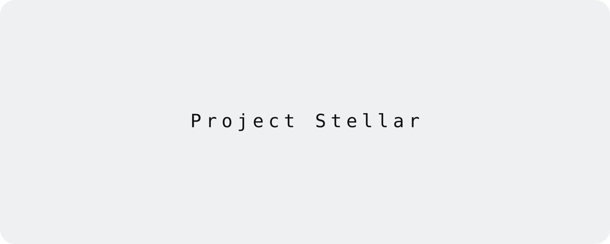

<!--
  README.md는 resources/README.preset.md를 기반으로 자동 생성됩니다.
  이 파일을 직접 수정한 내용은 재생성 시 사라집니다.
  내용을 바꾸려면 resources/README.preset.md를 수정한 뒤 ./scripts/readme_update.sh를 실행하세요.
-->

<!-- Hero Image -->
<!--
  히어로 이미지를 넣으려면 resources/hero.png를 추가하세요.
  라이트/다크 모드별 이미지는 resources/hero.light.png, resources/hero.dark.png로 추가합니다.
  같은 이름의 .jpg 파일도 지원합니다.
  이미지를 추가한 뒤 ./scripts/readme_update.sh를 실행하면 실제 존재하는 이미지가 resources/readme-hero.svg에 base64로 내장됩니다.
-->
<p align="center">
  <a href="https://github.com/taeyoon0137/project-stellar">
    
  </a>
</p>

<h1 align="center">Project Stellar</h1>
<p align="center">Stellar. Light, left behind.</p>

<p align="center">
  <a href="./docs/PROJECT_STELLAR_TECHNICAL_ARCHITECTURE.md"></a>
</p>
<p align="center">
  <a href="https://www.rust-lang.org/"></a>
  <a href="https://www.swift.org/"></a>
  <a href="https://learn.microsoft.com/windows/apps/winui/"></a>
</p>

- [🧭 역할](#-역할)
- [🚀 시작하기](#-시작하기)
- [📚 문서](#-문서)
- [🛠️ 스크립트](#️-스크립트)
- [🗂️ 저장소 구성](#️-저장소-구성)

<a id="role"></a>

## 🧭 역할

Project Stellar는 폴더와 실제 Git 저장소를 원본으로 사용하는 고성능 UI 디자인 소프트웨어입니다. macOS와 Windows에서 공통 Rust 코어를 사용하고, 각 운영체제의 네이티브 셸을 제공합니다.

핵심 목표는 다음과 같습니다.

- 입력 수신부터 변경 프레임의 GPU 제출과 Present 예약까지 5~10ms 안에 처리합니다.
- macOS와 Windows에서 결정론적인 문서, 텍스트, 레이아웃 결과를 만듭니다.
- 디자인 데이터를 실제 프로젝트 폴더와 실제 Git으로 관리합니다.
- 디자인 객체와 속성 단위의 Staging, 의미 기반 Diff와 Conflict 해결을 제공합니다.
- 플랫폼 Capability와 코드 생성으로 확장 가능한 공통 UI 모델을 유지합니다.

다음은 목표로 하지 않습니다.

- 실시간 공동 편집 서버나 CRDT·OT 기반 공식 협업 모델
- 자체 AI 모델이나 에이전트 런타임
- 클라우드 문서 서비스 형태의 제품

공식 협업 모델은 Git 기반 비동기 협업입니다.

<a id="getting-started"></a>

## 🚀 시작하기

현재 저장소는 아키텍처 기준선(Architecture Baseline) 단계입니다. 구현 코드(Rust 코어, 네이티브 셸, 렌더러)는 아직 포함되어 있지 않습니다. 기술 기준은 [`docs/PROJECT_STELLAR_TECHNICAL_ARCHITECTURE.md`](./docs/PROJECT_STELLAR_TECHNICAL_ARCHITECTURE.md)에, 단계별 구현·검증 계획은 [`docs/PROJECT_STELLAR_IMPLEMENTATION_PLAN.md`](./docs/PROJECT_STELLAR_IMPLEMENTATION_PLAN.md)에 정의되어 있습니다.

현재 단계에서 사용할 수 있는 명령은 README 재생성입니다.

```bash
./scripts/readme_update.sh
```

커밋 메시지 형식 검사 훅을 활성화하려면 저장소를 clone한 뒤 한 번 다음을 실행합니다.

```bash
git config core.hooksPath .githooks
```

빌드, 실행, 테스트 명령은 구현 단계에서 추가됩니다.

<a id="docs"></a>

## 📚 문서

- [`docs/PROJECT_STELLAR_TECHNICAL_ARCHITECTURE.md`](./docs/PROJECT_STELLAR_TECHNICAL_ARCHITECTURE.md): 제품 정의, 아키텍처 원칙, 성능 계약, 문서 모델, 파일 포맷, Git 동작, 로드맵을 담은 기술 기준 문서입니다. 구현 판단의 1차 기준입니다.
- [`docs/PROJECT_STELLAR_IMPLEMENTATION_PLAN.md`](./docs/PROJECT_STELLAR_IMPLEMENTATION_PLAN.md): 아키텍처 기준 문서를 원자적 작업 패키지(WBS)로 분해한 구현·검증 실행 계획입니다. 28개 Phase(I~XXVIII), 933개 작업, 단계 완료 게이트(G0~G8)를 정의하며 초기 릴리스 범위는 Phase I~XVII(G8)입니다.

<a id="scripts"></a>

## 🛠️ 스크립트

<!--
  README.md는 생성 결과물입니다.
  내용을 바꿀 때는 resources/README.preset.md를 수정한 뒤 ./scripts/readme_update.sh를 실행하세요.
  placeholder, 경로, 섹션 구조가 바뀌면 생성 스크립트도 함께 갱신합니다.
-->

| 명령                         | 설명                                                                                                                            |
| :--------------------------- | :------------------------------------------------------------------------------------------------------------------------------ |
| `./scripts/readme_update.sh` | `resources/README.preset.md`와 `resources/readme-hero.preset.svg`에서 `README.md`와 `resources/readme-hero.svg`를 재생성합니다. |

<a id="repository-structure"></a>

## 🗂️ 저장소 구성

```plaintext
project-stellar
├── .githooks/
│   └── commit-msg              # 커밋 메시지 형식 검사 훅
├── docs/
│   ├── PROJECT_STELLAR_IMPLEMENTATION_PLAN.md     # 원자적 구현·검증 실행 계획 (WBS)
│   └── PROJECT_STELLAR_TECHNICAL_ARCHITECTURE.md  # 기술 아키텍처 기준 문서
├── resources/
│   ├── README.preset.md        # README 생성 원본 (source of truth)
│   ├── readme-hero.preset.svg  # README 히어로 wrapper 원본
│   └── readme-hero.svg         # 생성된 README 히어로 SVG
├── scripts/
│   └── readme_update.sh        # README 생성 명령
├── .gitattributes              # 줄바꿈·속성 규칙
├── .gitignore                  # Git 추적 제외 규칙
├── AGENTS.md                   # 에이전트 작업 지침 (source of truth)
├── CLAUDE.md                   # AGENTS.md 심볼릭 링크
└── README.md                   # 생성 결과물
```
