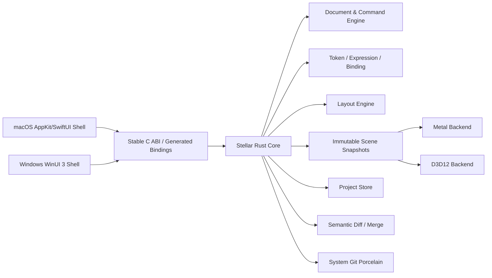

# Project Stellar 기술 아키텍처 명세

- 문서 상태: Architecture Baseline Draft
- 기준일: 2026-06-23
- 대상 제품: Stellar 데스크톱 애플리케이션
- 대상 독자: 제품 기획, 클라이언트·코어·렌더링·파일 포맷·Git 통합 엔지니어
- 범위: 기술 아키텍처와 제품 요구사항
- 제외 범위: 상세 UX, 화면 배치, 비주얼 스타일 가이드

---

## 1. 문서 목적

이 문서는 Stellar의 기술적 기준선을 확정합니다. 이후 구현 단계에서 모듈 경계, 성능 계약, 파일 포맷, Git 동작, 문서 모델과 로드맵 범위를 판단할 때 본 문서를 우선 기준으로 사용합니다.

초기 논의 중 변경된 결정은 최신 결정으로 대체했습니다. 아직 수치가 확정되지 않은 항목은 제품 요구사항이 아니라 벤치마크 또는 구현 검증 과제로 분리했습니다.

---

## 2. 제품 정의

Stellar는 폴더와 실제 Git 저장소를 원본으로 사용하는 고성능 UI 디자인 소프트웨어입니다. 핵심 목표는 다음과 같습니다.

1. 입력 수신부터 변경 프레임의 GPU 제출 및 Present 예약까지 5~10ms 안에 완료합니다.
2. macOS와 Windows에서 공통 코어를 사용하되 각 운영체제의 네이티브 애플리케이션 셸을 제공합니다.
3. 디자인 데이터는 실제 프로젝트 폴더와 실제 Git으로 관리합니다.
4. 디자인 객체·속성 단위 Staging과 의미 기반 Diff·Conflict 해결을 제공합니다.
5. 플랫폼별 UI 요소와 디자인 토큰, 조건식, 컴포넌트 바인딩을 결정론적으로 처리합니다.
6. 향후 외부 AI 에이전트, MCP, 플러그인, 코드 생성으로 확장할 수 있는 경계를 제공합니다.

Stellar는 Figma·Sketch 형식의 클라우드 문서 서비스나 실시간 공동 편집기를 목표로 하지 않습니다. 공식 협업 모델은 Git 기반 비동기 협업입니다.

---

## 3. 핵심 아키텍처 원칙

### 3.1 결정론

동일한 프로젝트 데이터, 폰트, Target Profile과 렌더 설정은 macOS와 Windows에서 동일한 레이아웃, 텍스트 줄바꿈, 상태 평가와 의미 구조를 생성해야 합니다.

### 3.2 증분 처리

문서 변경마다 전체 문서를 다시 계산하지 않습니다. 토큰, 바인딩, 레이아웃, Scene Graph, GPU 리소스와 저장 청크는 변경 영향 범위만 갱신합니다.

### 3.3 Git이 원본

Stellar는 Git을 재구현하지 않습니다. 시스템 Git 실행 파일이 명령을 수행하며, Stellar의 Git UI는 그 위의 Porcelain 계층입니다.

### 3.4 문서 상태와 편집 이력의 분리

Git Working Tree는 마지막 커밋과 현재 저장 상태의 차이를 나타냅니다. Undo/Redo는 현재 실행 세션의 사용자 편집 이벤트를 나타내며 Git 이력과 분리합니다.

### 3.5 네이티브 셸, 공유 코어

창, 메뉴, 접근성, 기본 입력 컨트롤과 운영체제 통합은 네이티브로 구현합니다. 문서 모델, 레이아웃, 표현식, 렌더링 의미, 저장, Semantic Diff·Merge는 Rust 공통 코어가 담당합니다.

### 3.6 공개 가능한 데이터 모델

파일 포맷과 의미 규칙은 장기적으로 공개 명세가 될 수 있도록 설계합니다. 초기 버전에서는 포맷이 안정화될 때까지 공식 공개 명세와 호환성 약속을 제공하지 않습니다.

---

## 4. 범위와 비목표

### 4.1 초기 출시의 핵심 범위

- 프로젝트 폴더 생성·열기·Clone
- 문서, Frame, Fragment, 그래픽, 텍스트, 이미지 편집
- 컴포넌트, Property, Slot, 토큰, Binding, 조건식
- View 변수와 Nullable 조합형 Variant
- 공통 레이아웃·상태·접근성 의미 모델
- Metal 및 Direct3D 12 렌더링
- 지연 자동 저장, 세대 기반 저장, 복구 스냅샷
- 시스템 Git 연동
- Semantic Status·Diff
- 객체·속성 단위 Stage·Unstage
- Commit·Push
- Semantic Conflict 해결
- Git 기반 외부 라이브러리
- 스키마 마이그레이션

### 4.2 로드맵

- 내장 네이티브 PTY 터미널
- MCP 서버와 `stellar-mcp` stdio 브리지(해당 Phase가 끝난 뒤 노출, ADR-0005 §7)
- 외부 에이전트의 문서 편집, 잠금, 출처 표시와 사용자 되돌리기
- PNG·SVG 내보내기
- HTML/CSS/JavaScript 및 Rust/WASM 플러그인 런타임
- Web·Apple·Android 코드 생성(CSS 기반 속성·Context·상태 머신·Motion 입력, ADR-0024, ADR-0025)
- CSS 기반 속성과 상태 머신 위의 노드 기반 프로토타이핑 편집기(ADR-0025)
- 선언형 Component Context(14.5, ADR-0025). 초기 출시에는 저장 번호 예약만 포함
- 임의의 두 스냅샷을 조합해 제3의 결과를 만드는 Merge Composer
- Headless `stellar` 명령과 CI 도구(AI와 무관한 L1이므로 준비되는 대로 앱에 포함할 수 있음, ADR-0005 §7)
- 사용자 구독 CLI를 연결하는 내장 에이전트 패널(ADR-0005, 해당 Phase가 끝난 뒤 노출)
- 세션 간 Undo/Redo 복원
- 프로젝트 무결성 진단 패널
- Git의 고급 기능을 위한 전용 UI
- Windows ARM64 지원

### 4.3 영구 비목표 또는 코어 제외

- Stellar 자체 실시간 공동 편집 서버
- CRDT·OT 기반 공식 협업 모델
- Stellar 자체 AI 모델 또는 에이전트 런타임
- 생성 코드와 Stellar 문서의 양방향 동기화
- 초기 버전의 PDF 내보내기
- 일반 Git 저장소를 Stellar 프로젝트로 자동 전환

실시간 공동 편집은 향후 제3자 플러그인이 구현할 수 있으나 Stellar 코어 데이터 모델에는 협업 메타데이터를 포함하지 않습니다.

---

## 5. 지원 플랫폼과 기준 하드웨어

### 5.1 운영체제와 CPU

| 플랫폼 | 최소 운영체제 | CPU 아키텍처 | 초기 지원 |
|---|---|---|---|
| macOS | macOS 26.0 | Apple silicon `arm64` | 지원 |
| Windows | Windows 11 | `x64` | 보류(ADR-0006) |
| Windows | Windows 11 | `ARM64` | 로드맵 |
| macOS | macOS 26.0 | Intel `x86_64` | 미지원 |

구형 운영체제용 호환 계층은 제공하지 않습니다.

2026-11-14 결정(ADR-0006)으로 Windows 지원은 보류합니다. 당분간 macOS만 지원하며, 코어는 플랫폼 중립을 유지해 재개할 수 있게 둡니다.

### 5.2 성능 기준 하드웨어

| 플랫폼 | 기준 장치 |
|---|---|
| macOS | Apple M1, 메모리 16GB |
| Windows | 2020년 전후 6코어 CPU, 메모리 16GB, DirectX 12 지원 내장 GPU |

이보다 낮은 사양에서도 실행할 수 있으나 성능 계약의 보장 대상은 아닙니다.

### 5.3 성능 보장 문서 규모

| 항목 | 기준 상한 |
|---|---:|
| 프로젝트 전체 노드 | 1,000,000 |
| 활성 문서 노드 | 200,000 |
| 한 프레임의 가시 노드 | 20,000 |
| 활성 문서의 컴포넌트 인스턴스 | 50,000 |
| 컴포넌트 중첩 깊이 | 64 |
| 동시에 열린 문서 | 10 |
| 프로젝트 에셋 총량 | 20GB |

성능 계약은 위 범위와 기준 하드웨어에서 정의된 표준 시나리오를 기준으로 검증합니다.

---

## 6. 인터랙션 성능 계약

### 6.1 측정 범위

```text
T0  운영체제 입력 이벤트를 Stellar가 수신
T1  이벤트 병합·좌표 변환·Hit Test 완료
T2  Command 생성 및 문서 트랜잭션 반영 완료
T3  토큰·Binding·레이아웃 증분 갱신 완료
T4  Scene Snapshot·Render Graph 갱신 완료
T5  GPU 명령 제출 및 Present 예약 완료
```

핵심 지표인 `Logical Interaction Latency`는 `T5 - T0`입니다. 실제 패널 픽셀 변경 시점은 GPU 실행, 운영체제 compositor와 디스플레이 주사율에 영향을 받으므로 별도 관측 지표로 둡니다.

### 6.2 단계별 예산

| 단계 | 목표 | 절대 상한 |
|---|---:|---:|
| 입력 전달 및 이벤트 병합 | 0.15ms | 0.30ms |
| Hit Test 및 인터랙션 해석 | 0.35ms | 0.75ms |
| Command 생성 및 문서 변경 | 0.50ms | 1.00ms |
| 의존성·토큰·Binding 재평가 | 0.60ms | 1.00ms |
| 증분 레이아웃 | 1.00ms | 1.75ms |
| Scene Snapshot 갱신 | 1.00ms | 1.75ms |
| Render Graph 및 명령 인코딩 | 0.75ms | 1.25ms |
| GPU 제출 및 Present 예약 | 0.20ms | 0.50ms |
| 스케줄링·메모리 여유 | 1.40ms | 1.70ms |
| **합계** | **5.95ms** | **10.00ms** |

### 6.3 판정 기준

| 지표 | 기준 |
|---|---:|
| p50 | 5ms 이하 |
| p95 | 7ms 이하 |
| p99 | 9ms 이하 |
| 통제 가능한 단일 인터랙션 상한 | 10ms 이하 |
| 인터랙티브 GPU 실행 시간 | p99 4ms 이하 |
| Present 대기열 깊이 | 최대 1프레임 |
| UI 또는 문서 스레드의 단일 점유 구간 | 최대 2ms |

운영체제 선점, 드라이버 정지, 절전 상태 전환처럼 Stellar가 통제할 수 없는 지연은 별도 분류합니다. 평균값만으로 릴리스 여부를 판정하지 않습니다.

### 6.4 작업별 계약

- Pan, Zoom, Drag, Resize, Rotate: Present 예약까지 10ms 이하
- Hover, 선택, 핸들 표시: 목표 5ms, 상한 8ms
- 단일 속성, 토큰, 텍스트 변경: 10ms 이하
- 화면에 보이는 컴포넌트 인스턴스 전파: 10ms 이하
- Undo/Redo의 현재 화면 결과: 10ms 이하
- 대규모 Paste·Delete·토큰 교체: 최초 시각 반응 10ms 이하, 전체 처리는 청크 분할
- 저장, Git, 네트워크, 외부 프로세스: 인터랙션 동기 경로에서 실행 금지
- 폰트·이미지·셰이더 캐시 미스: 저비용 대체 결과를 우선 표시하고 비동기 정교화

---

## 7. 소스 저장소와 모노레포

Stellar 자체 소스는 하나의 모노레포로 관리합니다.

```text
stellar/
├── apps/
│   ├── macos/
│   └── windows/
├── crates/
│   ├── document/
│   ├── commands/
│   ├── history/
│   ├── expressions/
│   ├── bindings/
│   ├── layout/
│   ├── scene/
│   ├── renderer-core/
│   ├── renderer-metal/
│   ├── renderer-d3d12/
│   ├── text/
│   ├── storage/
│   ├── semantic-diff/
│   ├── semantic-merge/
│   ├── git-porcelain/
│   ├── dependencies/
│   └── diagnostics/
├── schemas/
├── sdk/
├── tests/
├── benchmarks/
└── tools/
```

### 7.1 내부 Git submodule 정책

코어, 스키마, 플랫폼 앱과 렌더러를 내부 submodule로 분리하지 않습니다. 이들은 하나의 변경으로 함께 진화해야 하므로 원자적 커밋이 가능한 모노레포가 적합합니다.

Submodule은 다음 조건을 모두 만족하는 외부 코드에만 예외적으로 허용할 수 있습니다.

- Stellar와 독립적으로 릴리스됩니다.
- 특정 커밋을 정확히 고정해야 합니다.
- Stellar 내부 코드와 같은 PR에서 자주 함께 수정되지 않습니다.
- 일반 패키지 관리자로 받을 수 없습니다.

제품 사용자가 참조하는 디자인 라이브러리는 소스 코드 submodule이 아니라 별도의 Git 기반 의존성 시스템으로 관리합니다.

---

## 8. 상위 런타임 아키텍처



### 8.1 플랫폼 셸

#### macOS

- Swift
- AppKit 중심
- 필요한 영역에 SwiftUI 사용
- Liquid Glass와 운영체제 네이티브 창·메뉴·입력·접근성 사용

#### Windows

- C++/WinRT
- WinUI 3
- Fluent 기반 네이티브 창·메뉴·입력·접근성 사용

플랫폼 셸은 문서 의미나 파일 포맷을 소유하지 않습니다. Stellar 본체 UI는 Electron, DOM 또는 WebView 기반으로 구현하지 않습니다. WebView는 향후 플러그인 UI의 격리된 호스트로만 사용합니다.

### 8.2 공통 코어와 셸 경계

- 안정적인 C ABI 또는 생성된 FFI 바인딩 사용
- ABI에 Rust 내부 타입을 직접 노출하지 않음
- Handle, POD 데이터, 버전형 메시지와 명시적 수명 관리 사용
- 고빈도 입력은 작은 고정 구조체 또는 ring buffer로 전달
- 대규모 문서 데이터는 FFI를 반복 왕복하지 않고 Snapshot·Command 단위로 전달

---

## 9. 프로세스와 스레드 모델

### 9.1 프로세스 경계

앱 프로세스 안에서 실행합니다.

- 네이티브 애플리케이션 UI
- 문서 모델
- Command·Undo/Redo
- 레이아웃
- Scene Snapshot
- Metal·D3D12 렌더러

별도 프로세스로 실행합니다.

- 시스템 Git
- 향후 내장 터미널 셸
- Claude Code, Codex 등 외부 CLI
- 향후 고권한 플러그인
- 필요 시 파일 파서·썸네일 워커

핵심 입력·편집·렌더링 경로에는 프로세스 간 통신을 두지 않습니다.

### 9.2 앱 내부 스레드

```text
Native UI Thread
  └─ 이벤트 수신, 네이티브 UI, IME·접근성 연결

Document Thread
  └─ 유일한 문서 작성자, Command 순차 적용, Undo/Redo

Render Thread
  └─ 불변 Scene Snapshot 읽기, GPU 명령 생성·제출

Worker Pool
  ├─ Text shaping
  ├─ Tessellation
  ├─ 이미지 디코딩
  ├─ 저장 직렬화
  └─ 캐시 생성
```

문서 모델에 대한 다중 스레드 동시 쓰기는 금지합니다. 워커 결과는 입력 해시와 문서 세대가 현재 상태와 일치할 때만 반영합니다.

### 9.3 문서와 렌더러 간 전달

- 불변 증분 `SceneSnapshot` 사용
- 변경되지 않은 데이터는 이전 스냅샷과 구조적으로 공유
- 렌더 스레드는 잠금 없이 읽기
- 문서 스레드는 렌더 완료를 기다리지 않음
- 오래된 렌더 결과는 세대 번호로 폐기
- 스냅샷 수명은 참조 카운트 또는 epoch 기반 회수

---

## 10. 렌더링 아키텍처

### 10.1 공통 계층과 백엔드

```text
Document Graph
  → Incremental Style / Token / Binding Evaluation
  → Incremental Layout
  → Retained Scene Graph
  → Immutable Scene Snapshot
  → Visibility Culling / Dirty Region
  → Render Graph
  → Metal 또는 Direct3D 12
```

공통 Rust 계층이 다음을 담당합니다.

- Scene Graph 의미
- Render Graph
- 가시성 컬링
- Dirty region
- 그래픽·텍스트 캐시
- Draw batching
- 렌더링 적합성 규칙

플랫폼 백엔드가 다음을 담당합니다.

- GPU 리소스 수명
- 파이프라인과 셰이더 변형
- 명령 인코딩
- 큐 제출과 동기화
- Swap chain 또는 drawable
- Present 예약

`RendererBackend` 인터페이스 뒤에서 Metal과 D3D12를 격리합니다. 공통 코어가 플랫폼 GPU 객체를 직접 참조해서는 안 됩니다.

### 10.2 플랫폼 간 결과 일관성

- 레이아웃 좌표, 텍스트 줄바꿈, 의미 색상과 상태 결과는 동일해야 합니다.
- 픽셀 바이트 완전 일치가 아니라 명시적 허용 오차 안의 시각적 동등성을 요구합니다.
- 셰이더·블렌딩·필터별 허용 오차는 렌더 적합성 테스트에서 고정합니다.
- 앱 셸은 Liquid Glass와 Fluent로 다르게 표현할 수 있습니다.
- 캔버스 프리뷰는 실행 운영체제가 아니라 선택한 Target Profile을 기준으로 렌더링합니다.

### 10.3 색상

- 내부 색상 연산과 알파 합성은 선형 색공간에서 수행
- 색상 값과 색공간 메타데이터를 함께 저장
- 초기 지원: sRGB, Display P3
- Target Profile로 변환할 때 gamut 경고 제공
- Gradient, Blend, Blur, Shadow 계산 규칙을 두 백엔드에서 공통 정의
- HDR은 초기 제외, 스키마만 확장 가능하게 설계

### 10.4 캐시

예산 기반 다단계 캐시를 사용합니다.

우선 보존:

1. 현재 문서 모델
2. 현재 Scene Snapshot
3. 현재 화면에 필요한 GPU 리소스

우선 제거:

1. 비활성 문서 썸네일
2. 화면 밖 이미지 mipmap
3. 재생성 가능한 tessellation
4. 사용 빈도가 낮은 glyph atlas 페이지

시스템 CPU·GPU 메모리 압박을 감지해 예산을 동적으로 조정합니다.

---

## 11. 텍스트 아키텍처

### 11.1 디자인 결과 텍스트

텍스트 레이어, 컴포넌트 문구, 프리뷰와 향후 내보내기는 공통 결정론적 텍스트 엔진을 사용합니다.

- HarfBuzz 기반 shaping
- 공통 Unicode BiDi 처리
- 공통 줄바꿈
- 명시적 fallback
- 공통 폰트 메트릭
- 공통 glyph outline·atlas 파이프라인
- 동일 폰트와 설정에서 플랫폼 간 glyph 배치와 줄바꿈 일치

캔버스 텍스트 편집에서도 최종 레이아웃은 공통 엔진을 사용합니다. 한글·중국어·일본어 IME, dead key, 받아쓰기, 클립보드는 네이티브 입력 서비스와 연결합니다.

### 11.2 애플리케이션 UI 텍스트

다음은 네이티브 컨트롤을 사용합니다.

- 레이어·페이지·문서 이름
- 검색과 명령 입력
- 속성 패널 입력
- 토큰·브랜치·커밋 이름
- 설정과 다이얼로그
- Git 커밋 메시지

macOS는 AppKit 텍스트 컨트롤, Windows는 WinUI 텍스트 컨트롤을 사용합니다.

### 11.3 폰트 소스

- `Project Font`
- `System Font`
- `External Font`

프로젝트에는 다음을 기록합니다.

- 폰트 파일 콘텐츠 해시
- face index
- variation axes
- OpenType feature 설정
- fallback 규칙

재현성이 필요한 폰트는 프로젝트 에셋 또는 버전 고정 패키지에 포함합니다. 시스템 폰트는 허용하되 다른 환경에서의 누락 가능성을 표시합니다. 라이선스상 저장 가능한 폰트만 Git에 포함합니다.

---

## 12. 문서 도메인 모델

### 12.1 영속 ID

모든 영속 객체는 128비트 UUIDv7 `StableId`를 가집니다.

- 이름, 경로, 부모, 콘텐츠와 독립
- 속성 변경, 이동, 이름 변경, 청크 이동 시 유지
- 복제·붙여넣기 시 복제 그래프 전체에 새 ID 발급
- 삭제된 ID 재사용 금지
- 외부 가져오기 충돌 시 관련 그래프를 원자적으로 재매핑
- 시간 순서는 계층 또는 레이어 순서에 사용하지 않음

런타임에서는 별도의 밀집 `EntityId`를 사용할 수 있습니다.

### 12.2 기본 노드

```text
Definition Resources
├─ ViewDefinition
├─ ComponentDefinition
└─ ControlContractDefinition

Scene Nodes
├─ Frame
├─ Fragment
├─ Shape
├─ Path
├─ Text
├─ Image
└─ ComponentInstance
```

`ViewDefinition`은 Root Frame을 소유합니다.

### 12.3 Frame

Frame은 다음 Capability를 조합할 수 있는 기본 컨테이너입니다.

- Layout
- Paint
- Children
- Clip
- Semantic Contract
- Interaction Contract
- State Machine

`Control`은 별도 영속 노드 타입이 아니라 Frame에 의미·상호작용 계약을 부여한 구성입니다.

### 12.4 Fragment

Fragment는 완전한 구조 노드입니다.

허용:

- 이름
- StableId
- 자식 순서
- 잠금
- 표시 여부
- 편집 메타데이터

금지:

- 자체 레이아웃 박스
- 좌표계
- 배경·테두리·패딩·클리핑
- Transform
- Opacity
- Blend
- Mask
- Filter

변형이나 효과가 필요하면 Frame으로 변환합니다. 내보내기 시 Fragment 자체는 제거되고 자식만 부모에 포함됩니다.

### 12.5 초기 Control 계약

초기 기본 제공 계약은 다음 네 가지입니다.

- Button
- TextInput
- Modal
- List

이 목록은 파일 스키마의 폐쇄형 enum이 아니며 향후 추가·축소할 수 있습니다.

예:

```text
Button = Frame + Action Semantic + Activate/Focus Contract
TextInput = Frame + Editable Value + Text Input/IME/Focus Contract
Modal = Frame + Overlay + Focus Scope + Dismiss Contract
List = Frame + Collection + Navigation/Selection Contract
```

RadioButton 등은 별도 기본 노드를 만들지 않고 Button과 List를 합성합니다. 시각적 조합과 접근성 의미는 분리합니다.

### 12.6 비파괴 Modifier Stack

그래픽 노드는 원본 형상을 유지하고 순서가 명시된 Modifier Stack을 가집니다.

예시:

- Transform
- Boolean
- Stroke expansion
- Corner processing
- Mask·Clip
- Fill·Stroke
- Shadow·Blur
- Blend·Opacity

각 Modifier는 StableId를 가지며 개별 편집, 비활성화, 재정렬, Diff·Merge가 가능합니다. 다른 노드를 참조하는 Modifier는 의존성 그래프로 관리하고 순환 참조를 차단합니다. Path로의 파괴적 변환은 사용자가 명시적으로 실행할 때만 허용합니다.

### 12.7 자식 순서

자식 순서는 배열 인덱스 자체를 정체성으로 사용하지 않습니다. 동시 브랜치 삽입과 안정적 Merge가 가능하도록 별도의 결정론적 OrderKey를 사용합니다. 구체 알고리즘은 벤치마크와 Merge 테스트 후 확정합니다.

### 12.8 런타임 저장 구조

영속 `StableId`와 별도로 실행 중에는 밀집 `EntityId`를 사용합니다.

- Arena 또는 Structure-of-Arrays 기반 속성 저장
- 노드별 세밀한 heap allocation 최소화
- 가시 영역과 Hit Test용 공간 인덱스
- Token·Binding·Component·Context 의존성 DAG
- 레이아웃·텍스트 shaping·path tessellation 캐시
- StableId ↔ EntityId 양방향 인덱스
- 비활성 청크를 위한 lazy materialization

문서 스키마의 객체 계층과 런타임 메모리 배치는 동일할 필요가 없습니다. 저장 포맷의 안정성과 인터랙션 성능을 분리합니다.

---

## 13. 레이아웃 엔진

Stellar는 운영체제의 실제 CSS, Auto Layout, SwiftUI, Compose 엔진을 캔버스 계산에 직접 사용하지 않습니다.

공통 결정론적 모델은 다음을 지원합니다.

- 자유 배치·절대 좌표
- Stack·Flex 계열
- Grid
- Overlay
- Anchor·Constraint
- 콘텐츠 기반 크기
- 최소·최대 크기
- 비율
- 반응형 조건

Target Profile Adapter는 공통 결과가 Web·Apple·Android에서 표현 가능한지 검사합니다. 표현할 수 없는 설정을 조용히 왜곡하지 않고 `unsupported`, `approximated`, `fallback` 등의 진단 상태를 제공합니다.

디자인 속성의 이름, 값 문법, 단위, 상자·레이아웃 의미는 CSS longhand를 정본 어휘로 삼습니다(ADR-0024). 이는 어휘 결정이며 저장 형식은 바이너리 청크(§21)와 숫자 속성 키를 그대로 쓰고, 계산은 위 공통 결정론적 엔진이 합니다. longhand 하나가 속성 키 하나이며, 속성 단위 병합(§27.1)과 값 연결의 단위도 이 키입니다. Stellar가 받아들인 선언은 같은 CSS 선언과 같은 결과를 내야 하며, 허용하는 예외와 세부 대응은 `docs/design/property_model.md`에 둡니다.

---

## 14. 토큰, 표현식과 Binding

### 14.1 GUI 우선 표현식

사용자는 GUI 기반 표현식 편집기로 조건과 연산을 구성합니다. 내부 원본은 타입이 지정된 Expression AST입니다.

각 AST 노드는 StableId를 가지며 Semantic Diff·Merge가 가능합니다.

지원 타입 예시:

- Number
- Boolean
- String
- Length
- Percentage
- Angle
- Duration
- Color
- Gradient
- Shadow
- Typography
- Enum
- Resource reference
- Component reference
- Structured token

지원 연산:

- 산술: `+`, `-`, `×`, `÷`, 나머지
- 함수: `min`, `max`, `clamp`, `abs`, `round`, `floor`, `ceil`
- 보간·범위 변환·단위 변환
- 비교와 논리
- `if`, `else`, `switch`, `match`
- 제한된 문자열 결합·치환·포맷팅
- 색상 혼합·투명도·색공간 변환

타입 규칙 예:

```text
length + length  → length
length × scalar  → length
length ÷ length  → number
length + color   → type error
```

금지:

- 임의 JavaScript
- 파일·네트워크·Git·터미널 접근
- 현재 시각과 비결정적 난수
- 전역 상태 변경
- 임의 반복문과 재귀
- 등록되지 않은 외부 함수

표현식은 수정 시 타입 검사와 의존성 분석을 완료하고, 인터랙션 시에는 검증된 AST 또는 bytecode만 평가합니다.

### 14.2 통합 Value Binding UX

사용자 UI에서는 Property Drilling, 변수, Context를 별도 기능처럼 구분하지 않습니다. 모든 속성은 하나의 Value Binding 인터페이스를 사용합니다.

연결 가능한 값:

- 고정값
- 토큰
- 다른 속성
- Component Property
- 상위 계층 전달값
- 조건식·연산식
- 플랫폼·상태별 값

내부에서는 타입화된 Binding Graph로 관리합니다.

```text
ValueNode
├─ StableId
├─ ValueType
├─ Scope
├─ Expression
├─ Dependencies
└─ Provenance
```

Stellar는 최종 값이 어떤 토큰, 조건, Property, Provider를 거쳤는지 출처 경로를 표시할 수 있어야 합니다.

### 14.3 컴포넌트 경계와 Property Drilling

Property Drilling 경계는 일반 레이어가 아니라 `ComponentDefinition` 경계입니다.

- 컴포넌트 경계를 넘는 Property 값은 공개 Component Property를 통해서만 전달
- Nested Instance의 Property를 상위 인스턴스에서 직접 편집 금지
- 상위 ComponentDefinition에 Property를 만들고 하위 Property에 명시적으로 Binding
- Property 값이 여러 경계를 통과하면 모든 경계에 Property가 존재해야 함
- 일반 Frame·Fragment는 Drilling 경계가 아님
- 예외: 14.5의 Component Context는 경계마다 Property를 두지 않고, 읽는 컴포넌트가 공개 인터페이스에 선언한 `ContextRequirement`로만 경계를 넘음(ADR-0025)

UI는 필요한 Property와 Binding 체인의 생성을 자동화할 수 있으나, 내부 모델에는 명시적 인터페이스로 저장합니다.

```text
App.theme
  → Card.theme
    → Button.theme
      → Button.background
```

### 14.4 Orphaned Binding

Property 삭제 또는 타입 변경으로 연결이 깨지면 자동 삭제하지 않습니다.

- 원본·대상 StableId 보존
- 마지막 유효 타입 보존
- Drilling 경로 보존
- 끊어진 위치와 원인 기록
- 렌더링은 대상 Property의 선언된 기본값 사용
- 모든 공개 Property는 유효한 기본값 필수
- 마지막 정상 계산값을 데이터로 저장하거나 사용하지 않음

프로젝트 전체의 끊어진 Binding과 누락 리소스를 모아 보는 진단 UI는 로드맵입니다.

### 14.5 Component Context

Context는 하위 트리로 값을 공급·소비하는 **선언된 인터페이스**입니다. 14.3의 "경계마다 Property" 규칙은 Property 값에 적용되고, Context는 이 절의 `ContextRequirement` 선언으로만 경계를 넘습니다(14.3의 예외). 15.1의 암묵적 참조 금지는 유지되며, 선언된 Context 소비는 암묵적 참조가 아닙니다(ADR-0025). 로드맵 기능이며 초기 출시에는 저장 번호 예약만 포함합니다(4.2).

- `ContextKey`: StableId, 이름, 타입, 필수 기본값을 가진 resource. 토큰과 같은 scope(프로젝트·라이브러리·문서)
- 제공: node에 붙는 `ContextProvision`이 key 하나에 값 하나를 연결하고, 펼친 instance 트리 기준 하위 트리에 적용
- 소비 선언: ComponentDefinition 안에서 Context를 읽으려면 공개 인터페이스에 `ContextRequirement`를 선언. 중간 컴포넌트는 다시 선언하지 않음
- 소비: Value Binding의 연결원 종류 하나
- 해석: 가장 가까운 조상 provision 우선, 없으면 key 기본값. 안쪽 provision이 바깥을 가림. provision 값이 같은 key를 읽으면 바깥 값
- Slot 콘텐츠: 작성 scope 기준으로 해석. slot host에서 컴포넌트 내부 조상을 건너뛰고 instance 위치로 이어 올라감. 컴포넌트 내부 provision은 Slot이 공개 인터페이스에 선언한 공개 key만 slot 콘텐츠에 보임
- cycle은 Binding cycle 검사로 저장 전 거부
- 출처 경로에 provision node를 기록하고 UI는 제공한 조상으로 이동할 수 있어야 함

특정 컴포넌트의 파라미터는 14.3의 Property Drilling을 쓰고, 테마·밀도처럼 하위 트리 범위의 개념에만 Context를 씁니다.

---

## 15. 컴포넌트와 인스턴스

### 15.1 인스턴스 편집

허용:

- 공개 Property 값 변경
- 허용된 스타일·텍스트·가시성 Override
- 공개 Slot에 콘텐츠 삽입
- 상위 ComponentDefinition에서 명시적으로 Drilling된 Nested Property 제어

금지:

- Nested Instance 내부 직접 편집
- 원본에 없는 임의 구조 편집
- 컴포넌트 경계를 건너는 암묵적 참조

자유 편집이 필요하면 명시적으로 Detach합니다. Override는 원본 복제가 아니라 `StableId + PropertyPath` 기반 희소 데이터로 저장합니다.

### 15.2 Slot

Slot은 ComponentDefinition이 명시적으로 공개해야 합니다. 공개되지 않은 위치에는 인스턴스가 임의 자식을 추가할 수 없습니다.

### 15.3 상태 머신

컴포넌트는 GUI 기반 선언형 상태 머신을 가질 수 있습니다.

- 타입화된 상태 변수
- 이벤트
- 조건
- 상태 전환
- 결과 Action

초기 이벤트 범위:

- Activate·Click
- Text input
- Focus·Blur
- Keyboard
- Selection
- Enabled·Disabled
- Modal open·dismiss

임의 JavaScript는 실행하지 않습니다. Nested Instance 상태도 직접 수정하지 않고 공개 Property와 Drilling을 사용합니다.

---

## 16. View 변수와 Nullable 조합형 Variant

프리뷰 런타임 상태는 저장하지 않습니다. 특정 화면 상태를 남기기 위해 ViewDefinition 자체에 변수를 정의하고 Variant Override를 작성합니다.

```text
ViewDefinition
├─ View Variables
├─ Base Structure
├─ Variant Rules
└─ State Machine
```

예:

```text
cartState: empty | populated
paymentState: idle | processing | error | completed
device: compact | regular
```

Variant 조건의 각 변수는 Nullable입니다.

```text
device = compact, paymentState = null
→ compact 전체에 적용

device = null, paymentState = error
→ 모든 device의 error에 적용

device = compact, paymentState = error
→ 해당 조합에만 추가 적용
```

`null`은 실제 null 값이 아니라 해당 변수를 조건으로 제한하지 않는 wildcard입니다. 실제 null 값이 필요한 타입은 `ExplicitNull`로 구분합니다.

적용 규칙:

```text
Base View
→ 일치하는 일반 Variant
→ 더 구체적인 조합 Variant
```

- 존재하지 않는 조합은 Override가 없는 것으로 처리
- 정의되지 않은 속성은 Base 또는 일반 Variant 값을 상속
- 더 구체적인 Variant가 같은 속성을 지정하면 우선
- 같은 구체성의 규칙이 같은 속성을 다르게 지정하면 오류
- Variant는 일반 레이어의 추가·삭제·이동·교체를 허용
- Nested Component 내부 변경은 Property·Drilling·Slot만 허용
- 모든 구조 Override는 StableId 기반 패치

프리뷰 중 사용자가 클릭해 바뀐 상태는 세션 메모리에만 남고 프로젝트나 Git을 변경하지 않습니다.

---

## 17. Target Profile과 플랫폼 Capability

### 17.1 Profile 종류

- Apple: 대상 플랫폼, 최소 OS 버전
- Android: API Level, UI 시스템 버전
- Web: 브라우저 기준선, CSS·접근성 Capability 집합

프로젝트는 Profile과 Capability 정의 버전을 고정합니다. Stellar 업데이트만으로 Target Profile이 자동 변경되지 않습니다.

### 17.2 공통 구조와 플랫폼 오버라이드

하나의 공통 레이어·컴포넌트 구조를 기준 원본으로 유지합니다. Target Profile별 차이만 희소 Override로 저장합니다.

상태 예:

- `native`
- `approximated`
- `unsupported`
- `deprecated`
- `fallback`

필터를 통해 특정 플랫폼에서 지원하지 않는 요소나 속성을 비활성화할 수 있습니다.

### 17.3 코드 생성

단방향 코드 생성만 로드맵에 포함합니다.

- Stellar 문서가 원본
- Web·Apple·Android Export Adapter 제공 가능
- 생성 코드의 역수입과 자동 동기화는 하지 않음
- 동일 입력에서 결정론적 생성
- 변환 불가·근사 변환 진단
- 입력은 CSS 기반 속성, Context, 상태 머신, Motion 정의이며 속성별 매핑은 Capability registry가 관리. CSS 속성 어휘·의미와 Web 매핑은 ADR-0024, 코드 생성 입력과 Context·Motion 매핑은 ADR-0025를 따름

---

## 18. 접근성 의미 모델

시각적 레이어와 독립된 접근성 트리를 가집니다.

지원 데이터:

- role
- label
- value
- state
- action
- 읽기 순서
- 그룹 관계

Button으로 구성한 Radio UI에도 `radio`, `radiogroup` 의미를 줄 수 있습니다. Target Adapter가 Apple, Windows, Web, Android의 접근성 구조로 변환합니다.

진단 예:

- 접근 가능한 이름 누락
- 의미 중첩 오류
- 키보드 접근 불가
- 읽기 순서와 시각 순서 불일치
- 선택 상태 누락

Stellar 애플리케이션 자체 UI는 각 운영체제의 네이티브 접근성 API를 사용합니다.

---

## 19. 프로젝트 폴더와 파일 구조

Stellar는 단일 패키지 파일이 아니라 프로젝트 폴더 자체를 엽니다.

[ADR-0059](adr/ADR-0059-text-source-files-with-chunk-cache.md)에 따라 목표 Git 원본은 의미 단위 텍스트 파일이고 chunk는 `.stellar/cache/`의 파생 데이터입니다. 아래 구조는 아직 기본인 기존 generation 형식입니다. 첫 전환 단위(V.10.1~V.10.3)는 [단일 View 텍스트 문법](spec/text-view-source-v1.md)의 명시적 export/open만 지원합니다. 전체 의미 왕복·저장 복구·외부 변경 검증(V.10.4~V.10.7)이 끝나기 전에는 기존 프로젝트의 기본 저장을 바꾸지 않습니다.

```text
ProjectName/
├── .git/                      # 일반 저장소
│   또는 .git                  # linked worktree의 gitfile
├── stellar.yaml
├── stellar.lock.yaml
├── .gitignore
├── .gitattributes
├── design/
│   ├── current.stellarref
│   ├── generations/
│   │   └── <manifest-hash>.stargen
│   └── objects/
│       └── sha256/<prefix>/<content-hash>.starchunk
├── assets/
│   └── sha256/<prefix>/<content-hash>.<ext>
└── .stellar/
    └── cache/                 # Git 제외
```

복구 스냅샷은 프로젝트 폴더가 아니라 운영체제별 Application Support 또는 App Data 영역에 저장합니다.

### 19.1 프로젝트와 Git의 관계

- `stellar.yaml`과 `.git` 디렉터리 또는 gitfile은 같은 루트에 존재
- 하나의 프로젝트 루트는 하나의 Git worktree
- linked worktree는 독립 프로젝트처럼 열 수 있음
- 동일 저장소의 여러 worktree를 동시에 열 수 있음
- 다중 루트 Workspace는 로드맵

일반 Git 저장소에 `stellar.yaml`을 추가해 자동 전환하는 기능은 제공하지 않습니다.

### 19.2 플랫폼 공통 경로 규칙

- Windows 예약 문자와 예약 이름 금지
- 대소문자만 다른 경로 금지
- Unicode NFC 정규화
- 내부 경로 구분자는 `/`
- 사용자 레이어 이름은 제한하지 않음
- 실제 저장 경로는 StableId 또는 ContentHash 기반

### 19.3 심볼릭 링크

파일·디렉터리, 프로젝트 내부·외부 대상의 심볼릭 링크를 전면 허용합니다.

- 링크 자체를 Git 항목으로 유지
- 외부 대상을 자동 복사하지 않음
- broken link와 순환 참조 표시
- 외부 링크의 변경도 파일 감시
- 플랫폼 간 재현 실패 가능성 경고
- 신뢰되지 않은 프로젝트에서는 외부 링크 내용을 MCP·터미널·에이전트에 노출하지 않음

---

## 20. YAML 매니페스트와 의존성 잠금

### 20.1 파일 분리

- `stellar.yaml`: 사용자가 관리하는 프로젝트 설정과 의존성 선언
- `stellar.lock.yaml`: Stellar가 결정론적으로 생성하는 정확한 해석 결과

두 파일 모두 Git으로 추적합니다.

### 20.2 YAML 제한

YAML 1.2 계열의 제한된 하위 집합을 사용합니다.

금지:

- 중복 키
- custom tag
- anchor와 alias
- 다중 문서
- 구현별 해석이 달라지는 암시적 타입

Lock 파일은 직접 편집 대상이 아닙니다.

### 20.3 예시

```yaml
schema_version: 1

project:
  id: 0195c530-3acd-7bc1-8414-c213f61cb965
  name: Project Stellar

target_profiles:
  - id: apple-desktop
    platform: apple
    minimum_os: "26.0"

  - id: web-modern
    platform: web
    baseline: modern

dependencies:
  design-system:
    source: git
    repository: git@github.com:example/design-system.git
    version: "v2.4.0"
```

```yaml
lock_version: 1

resolved:
  design-system@v2.4.0:
    repository: git@github.com:example/design-system.git
    commit: 8c5426e18c6e7d46f6a56a5b4237c84b5f3c58a1
    content_hash: sha256:example
    schema_version: 4
```

---

## 21. 청크 저장 아키텍처

### 21.1 선택한 모델

ADR-0059 이후 Git 원본은 읽을 수 있는 속성과 StableId를 가진 결정론적 텍스트입니다. 아래 chunk 모델과 §21.2의 generation 원자성은 현재 기존 프로젝트 호환 경로에 적용되며, 전환 후 chunk는 텍스트에서 다시 만들 수 있는 로컬 cache 역할을 합니다. 다중 텍스트 파일의 원자성은 V.10.5의 저장 journal로 검증합니다. V.10.1~V.10.3의 단일 View 파일은 한 파일의 temp/fsync/rename으로 저장하고 미지원 의미를 거부합니다.

논리 식별과 물리 저장을 분리합니다.

```text
Logical identity: immutable ChunkId
Physical object: ContentHash(serialized bytes)
Manifest mapping: ChunkId → ContentHash
```

- 문서·페이지 매니페스트와 레이어 하위 트리 청크 분리
- Frame, Section, Component 등 의미 경계를 우선 사용
- 변경된 청크만 새로 직렬화
- 비활성 청크는 지연 로딩
- 컴포넌트 정의, 토큰, 에셋 메타데이터는 별도 청크군
- 청크 분할·병합은 문서 의미 변경이 아니라 저장 최적화

정확한 목표 청크 크기와 분할 임계치는 실제 문서 벤치마크 후 결정합니다.

### 21.2 세대 기반 트랜잭션 저장

```text
1. 변경 청크를 새 ContentHash 경로에 기록
2. 각 청크 해시와 스키마 검증
3. ChunkId → ContentHash를 담은 새 generation manifest 기록
4. generation manifest 검증
5. current.stellarref를 원자적으로 교체
```

앱은 완성된 하나의 generation만 읽습니다. 저장 중 종료되면 이전 `current.stellarref`가 계속 유효합니다.

### 21.3 정리

참조되지 않는 청크는 보수적 mark-and-sweep으로 정리합니다. 다음에서 참조되는 객체는 제거하지 않습니다.

- 현재 Working Tree generation
- Git index에 준비된 generation
- HEAD가 가리키는 프로젝트 상태
- 복구 스냅샷
- 현재 열려 있는 문서 Snapshot

### 21.4 대안 비교와 선택 이유

| 방식 | 장점 | 문제 | 판단 |
|---|---|---|---|
| 문서별 단일 바이너리 | 단순, 순차 로딩 용이 | 작은 변경도 큰 파일 수정, 부분 로딩·Merge 불리 | 미선택 |
| 객체별 개별 파일 | 변경 범위 최소 | 수십만 파일, Git·파일 시스템·백신 비용 | 미선택 |
| 안정 경로의 가변 청크 | Git에서 수정으로 보임 | 세대 원자성·중복 제거·손상 검증 복잡 | 단독 사용 미선택 |
| 순수 ContentHash 청크 | 무결성·중복 제거 우수 | 논리적 동일 청크 추적과 Semantic Diff에 부족 | 단독 사용 미선택 |
| 단일 데이터베이스 | 질의·부분 갱신 용이 | Git delta·브랜치·복구·충돌 처리 불리 | 미선택 |
| `ChunkId + ContentHash` 혼합 | 논리 추적, 불변 저장, 원자성, 중복 제거 균형 | 매니페스트와 GC가 필요 | **선택** |

---

## 22. 자동 저장, 다중 창과 복구

### 22.1 지연 자동 저장

- 완료된 편집은 즉시 인메모리 모델에 반영
- 마지막 입력 뒤 짧은 debounce 후 변경 청크만 비동기 저장
- 연속 Drag·Scrub 중 디스크 쓰기 반복 금지
- `Save Now`, 창 종료, 앱 비활성화 시 flush
- 선택 변경은 파일에 저장하지 않음
- 임시 파일 기록 후 원자적 교체

Debounce 수치는 사용성·SSD 쓰기·복구 손실 범위 벤치마크로 확정합니다.

### 22.2 동일 프로젝트의 여러 창

같은 프로젝트를 여러 창에서 열 수 있으며 각 창은 독립된 인메모리 문서 상태와 Undo/Redo 스택을 가집니다.

- 창이 열릴 때 `BaseGeneration` 기록
- 포커스 시 디스크 generation 재검사
- 로컬 변경이 없으면 최신 generation으로 자동 갱신 가능
- 로컬 변경이 있고 디스크가 바뀌면 Stale 표시
- 저장 직전에 디스크 generation과 BaseGeneration 비교

충돌 시 시각적 Merge UI를 열지 않고 팝업으로 둘 중 하나만 선택합니다.

1. 현재 창의 전체 버전으로 저장
2. 디스크 최신 버전을 불러오고 현재 창 변경 폐기

자동 저장에서 충돌을 발견하면 자동 저장을 일시 중단하고 같은 팝업을 표시합니다. 이 정책은 동일 프로젝트 다중 창 저장 충돌에만 적용합니다. Git Conflict는 별도 Semantic Conflict UI를 사용합니다.

### 22.3 비정상 종료 복구

Stellar가 임시 복구 스냅샷을 관리하고 운영체제의 복구·재실행 기능과 연결합니다.

복구 대상:

- 미저장 문서 모델
- 열린 문서와 탭
- 창별 캔버스 위치와 확대율
- 창별 선택 상태
- 활성 Target Profile

복구하지 않는 대상:

- Undo/Redo 히스토리
- 터미널 프로세스와 출력
- 외부 AI 세션
- 실행 중 Git 명령

정상 저장 세대보다 최신 복구 스냅샷이 있을 때만 사용자에게 복구 여부를 묻습니다. 정상 종료 후 복구 데이터는 삭제합니다.

### 22.4 손상 복구

- 청크 해시와 매니페스트 참조 검증
- 현재 generation 손상 시 이전의 완전한 generation 탐색
- 정상 세대가 있으면 읽기 전용으로 열고 복구 선택 제공
- 손상 데이터는 덮어쓰지 않고 보존
- 정상 세대가 없으면 임의 부분 재구성 대신 진단 정보 제공

### 22.5 외부 파일 변경

Stellar는 프로젝트 폴더, 에셋과 허용된 심볼릭 링크 대상을 파일 감시기로 관찰합니다. 외부 에디터, 시스템 Git, 스크립트 또는 CLI 에이전트의 직접 수정은 같은 경로로 처리합니다.

```text
External bytes changed
→ generation·hash 확인
→ parse and schema validation
→ External Snapshot 구성
→ Semantic Diff
→ current window state와 reconciliation
```

- 유효하지 않은 외부 데이터는 현재 인메모리 모델에 부분 적용하지 않음
- 로컬 변경이 없으면 외부 Snapshot을 다시 불러오거나 하나의 Synthetic Command로 적용
- Synthetic Command로 적용한 유효 변경은 현재 세션에서 Undo 가능
- 로컬 변경이 있으면 `LoadedBase / CurrentMemory / ExternalDisk`를 비교
- 겹치지 않는 변경은 자동 재적용 가능
- 의미 충돌은 Semantic Conflict 경로로 전환
- Git checkout처럼 대규모 경로가 교체돼도 완성된 Snapshot 단위로 전환

다른 Stellar 창이 저장한 generation은 writer session metadata로 식별할 수 있습니다. 이 경우에는 22.2의 단순 두 선택지 정책을 우선 적용합니다. headless `stellar` 명령이 쓴 generation은 writer 종류로 구분해 이 절의 reconciliation 경로로 처리합니다(ADR-0005).

---

## 23. Undo/Redo

### 23.1 범위

초기 버전의 Undo/Redo는 현재 실행 세션에서만 유지합니다. 창 또는 프로젝트를 닫으면 폐기합니다.

### 23.2 통합 히스토리

문서 편집과 선택 변경을 같은 시간순 스택에 기록합니다.

- `Cmd/Ctrl+Z`: 마지막 이벤트 되돌리기
- `Cmd/Ctrl+Shift+Z`: 다시 적용
- 선택 변경은 프로젝트 파일과 Git 변경에 포함하지 않음
- Undo 중 복원된 선택은 새 히스토리 이벤트를 만들지 않음
- 창별로 독립된 스택 유지

### 23.3 그룹화

- Drag·Resize·Rotate: pointer down부터 up까지 하나
- 영역 선택: 최종 선택만 하나
- 동일 위치 텍스트 연속 입력: 하나
- 키보드 이동·크기 조절: 짧은 연속 입력 병합
- Slider·Scrub: 조작 시작부터 종료까지 하나
- 취소된 조작과 Hover: 기록하지 않음
- 향후 에이전트 작업: 정상 완료 또는 세션 종료 시 적용분 전체를 하나('중단됨' 표시 포함), 사용자 되돌리기는 별도 하나(31.5)

공통 `HistoryGroupingPolicy`만을 통해 도구별 예외를 정의합니다.

---

## 24. 시스템 Git 아키텍처

### 24.1 실행 원칙

Stellar는 Git 실행 파일을 번들하지 않고 시스템에 설치된 Git을 사용합니다.

탐색 순서:

1. 사용자 지정 Git 경로
2. 운영체제의 표준 설치 경로
3. `PATH`

발견 후 `git --version`과 기능 검사를 수행합니다. Git이 없으면 설치 안내를 제공합니다. 설치는 사용자 승인 없이 자동 실행하지 않습니다.

### 24.2 Porcelain UI

Stellar는 Git 명령, 종료 코드, 표준 출력·오류와 기계 판독 가능한 결과를 해석해 UI를 제공합니다.

- `.git` 내부 파일 직접 수정 금지
- 공식 Git 명령과 plumbing 명령만 사용
- 가능한 경우 `--porcelain`, `-z`, 명시적 format 사용
- 인증, hooks, filters, worktree, refs와 index 의미는 Git에 위임

시스템 Git이 제공하는 기능을 프로젝트 구조가 막아서는 안 됩니다. 전용 UI가 없어도 외부 터미널에서 모든 Git 기능을 사용할 수 있어야 합니다.

### 24.3 프로젝트 신뢰

처음 여는 프로젝트는 제한 모드입니다. 신뢰 전에는 다음을 비활성화합니다.

- 저장소 내부에서의 시스템 Git 실행
- hooks와 filters
- 외부 diff·merge driver
- 터미널
- MCP와 에이전트
- 프로젝트가 지정한 외부 명령

사용자가 신뢰한 뒤 일반 Git 동작을 활성화합니다. Stellar의 신뢰 등록은 Git 전역 설정을 변경하지 않습니다.

### 24.4 초기 Git UI

초기 포함:

- Status
- Semantic Diff
- 객체·속성 단위 Stage·Unstage
- Commit
- Push
- Semantic Conflict 해결

로드맵:

- Branch·Switch
- Fetch·Pull
- Merge·Rebase
- Stash
- Worktree 관리
- Remote 관리
- Cherry-pick·Revert·Reset·Restore
- Tag·Notes·Reflog·Bisect
- Interactive rebase와 고급 patch 작업

위 기능은 초기에도 시스템 Git과 외부 터미널로 사용할 수 있습니다.

### 24.5 Git 인증

- HTTPS: 시스템 Git Credential Helper
- SSH: 사용자 SSH Agent와 Git 설정
- macOS Keychain·Windows Credential Manager 연동은 Git에 위임
- Stellar는 토큰, 암호, 개인 키 저장 금지

---

## 25. 프로젝트 생성과 Remote

### 25.1 새 프로젝트

사용자는 상위 디렉터리와 새 폴더 이름을 지정합니다.

Stellar가 수행합니다.

```text
1. 새 디렉터리 생성
2. git init -b main
3. stellar.yaml, stellar.lock.yaml, .gitignore, .gitattributes 생성
4. 기본 프로젝트 generation 생성
5. 기본 파일 Stage
6. 최초 Commit
```

최초 커밋 메시지:

```text
New Stellar project initialized
```

Git `user.name`, `user.email`이 없으면 커밋 전에 설정을 요청합니다.

### 25.2 기존 프로젝트

- 기존 Stellar 프로젝트 폴더 열기
- 기존 Stellar 저장소 Clone 후 열기
- `stellar.yaml` 없는 Git 저장소는 전환 불가

### 25.3 GitHub 연결

초기에는 GitHub 전용 연결 UI만 제공합니다.

- Stellar에서 GitHub 저장소를 생성하지 않음
- 기존 빈 GitHub 저장소 URL만 연결 가능
- 원격에 기존 커밋이 있으면 최초 연결·Push 중단
- 기존 이력이 있는 저장소는 Clone해서 사용
- 강제 Push 제공하지 않음
- GitHub 외 Remote 등록은 외부 터미널 사용
- 이미 등록된 어떤 Remote에도 Stellar Push UI 사용 가능

---

## 26. Semantic Status, Diff와 Staging

### 26.1 변경 기준

Git 변경사항은 편집 이벤트 로그가 아니라 다음의 의미 차이입니다.

```text
HEAD Snapshot
Index Snapshot
Working Tree Snapshot
```

Stellar는 마지막 커밋 이후의 현재 상태를 보여줍니다. Undo/Redo 이벤트는 별도입니다.

### 26.2 의미 단위

기본 식별:

```text
StableId + PropertyPath
```

Diff 예:

- 노드 추가·삭제·이동
- Property 변경
- Modifier 추가·재정렬
- Token 값·타입 변경
- Component Property·Slot 변경
- Binding 경로 변경
- View Variant Override 변경

### 26.3 객체·속성 단위 Staging

사용자가 선택한 의미 변경만 Stage할 수 있습니다.

안전한 구현 절차:

```text
1. 현재 Git index에서 Index Snapshot 구성
2. 선택된 Semantic Change를 Index Snapshot에 적용
3. 참조·스키마·컴포넌트·토큰 무결성 검증
4. 결정론적으로 관련 파일·청크 직렬화
5. 시스템 Git으로 blob 기록
6. 임시 index 또는 공식 update-index 명령으로 경로 반영
7. 성공 시 실제 index 갱신
```

Working Tree 파일을 Stage 목적으로 임시 수정하지 않습니다. 참조 무결성이 깨지는 부분 Stage는 차단하거나 필수 의존 변경을 함께 선택하도록 합니다.

Git index가 Staged 상태의 유일한 원본입니다. Stellar의 UI 캐시를 별도 원본으로 취급하지 않습니다.

실제 index 적용은 기존 trusted GitRunner의 stdin 승인 경계를 사용합니다. 공식 Git 자식이
index lock inode를 쓰기 FD로 보유하는지 확인한 뒤 잠금 안에서 기준 snapshot·index bytes·flags를
비교하고, 검증된 여러 경로를 하나의 `update-index --index-info` 입력으로 전달합니다. 파일 존재나
고정 대기 시간은 잠금 소유 증거가 아닙니다. 승인 전 실패에는 EOF를 보내지 않고 Git을 취소합니다.
적용 뒤에는 Index provider를 다시 읽습니다. 결과 소유를 확인할 수 없는 상태는 진단하며 외부
변경을 무조건 복원으로 덮지 않습니다. 현재 검증된 OS/Git/index 지원 범위는
`docs/task-reports/XIV.6.2.md`에 기록합니다.

---

## 27. Semantic Merge와 Conflict

### 27.1 속성 단위 3-way Merge

```text
Base
Ours
Theirs
```

`StableId + PropertyPath` 기준으로 비교합니다.

자동 병합:

- 서로 다른 객체 변경
- 같은 객체의 서로 다른 Property 변경
- 같은 Property를 같은 값으로 변경
- 독립된 토큰 변경
- 충돌하지 않는 자식 삽입

Conflict:

- 같은 Property에 서로 다른 값
- 삭제 대 수정
- 동일 자식의 상충 재정렬
- Token 타입 변경 대 값 변경
- Component Property 삭제 대 사용처 추가
- Context·Binding 공급자 삭제 대 참조 추가
- 동일 StableId의 불일치 정의

### 27.2 해결 UI

- Base·Ours·Theirs와 결과를 동일한 Conflict Graph로 표시
- 시각적 캔버스와 Property 단위 선택 지원
- 해결 결과 검증 후 프로젝트 파일 작성
- 시스템 Git `add`로 resolved 상태 전환
- `merge --continue`, `rebase --continue`, commit은 Git UI 로드맵 또는 외부 터미널에서 실행

### 27.3 동일 프로젝트 다중 창 충돌과의 구분

동일 프로젝트를 여러 창에서 열어 발생한 저장 충돌에는 Semantic Merge UI를 사용하지 않습니다. 현재 창 또는 디스크 버전 중 하나를 선택하는 단순 팝업 정책을 사용합니다.

### 27.4 Merge Composer 로드맵

임의의 Source A와 Source B를 불러와 독립 Candidate C를 만드는 기능은 로드맵입니다.

- Branch, commit, tag, worktree, HEAD, index, Working Tree를 Source로 사용
- 공통 이력이 있으면 merge-base 활용
- 결과 C는 A·B를 직접 변경하지 않는 가상 Snapshot
- 유효성 검증 후 새 branch·worktree 또는 현재 작업에 적용

---

## 28. Worktree

Git worktree는 에이전트 전용 기능이 아니라 일반 Git 기능입니다.

- 하나의 Stellar 창은 하나의 worktree 루트를 엶
- `.git` 디렉터리 또는 gitfile 모두 지원
- 같은 저장소의 여러 worktree를 여러 창에서 동시에 열 수 있음
- worktree마다 HEAD, index, Working Tree가 독립
- Stellar는 `git rev-parse` 결과로 루트·개별 Git dir·common Git dir를 판별
- 전용 Worktree UI는 로드맵

향후 임시 격리 작업 공간을 만드는 프리셋을 제공할 수 있으나 Git의 일반 worktree 동작을 그대로 사용합니다.

### 28.1 현재 작업 상태 복제 프리셋

일반 `git worktree add`는 커밋에서 새 worktree를 만들고 독립 index를 생성합니다. Stellar는 로드맵의 일반 Worktree UI에서 현재 작업 상태까지 복제하는 선택적 프리셋을 제공할 수 있습니다. 이는 에이전트 전용 기능이 아닙니다.

복제 범위:

- 현재 HEAD
- Staged 상태를 포함한 index
- Tracked unstaged 변경
- Untracked 파일
- 파일 삭제, 실행 권한과 심볼릭 링크

기본 제외:

- ignore 규칙에 의해 제외된 파일
- `.git` 관리 데이터

Ignored 파일은 명시적 allowlist로만 포함하며 `.env`, 개인 키, 인증서 등 민감 가능 파일은 별도 경고합니다. Unmerged index에서는 일반 Snapshot 복제를 수행하지 않고 기존 Semantic Conflict 해결 경로를 사용합니다.

---

## 29. 에셋과 Git LFS

### 29.1 에셋 반입

기본 가져오기 동작은 프로젝트 내부 복사입니다.

- `assets/`에 ContentHash 기반 저장
- 같은 콘텐츠 중복 저장 방지
- 외부 원본 경로는 선택적 출처 정보
- 외부 파일 변경 자동 반영 금지
- `Update from Source` 명시 실행
- clone·worktree·프로젝트 이동에서 재현 가능

### 29.2 Git LFS

프로젝트별 선택적 정책을 사용합니다.

- 일반 에셋은 기본 Git
- 크기·확장자 정책을 넘으면 LFS 권고
- Git LFS 설치 여부를 시스템 명령으로 확인
- 사용자 승인 후 `.gitattributes` 수정
- 기존 Git 이력을 자동 마이그레이션하지 않음
- LFS 객체가 없으면 문서는 열되 누락 에셋 표시
- 기본 임계치는 저장소 벤치마크 후 확정

---

## 30. Git 기반 외부 라이브러리

### 30.1 구조

컴포넌트·토큰 라이브러리는 독립 Git 저장소입니다.

- `stellar.yaml`에 URL과 버전 조건 선언
- `stellar.lock.yaml`에 정확한 commit, ContentHash, 스키마, 전이 의존성 고정
- 사용자별 외부 공용 캐시에 다운로드
- 같은 버전은 여러 프로젝트가 공유
- 읽기 전용으로 로드
- 오프라인에서는 캐시 사용
- 로컬 개발 시 로컬 경로나 worktree override 가능

### 30.2 수정 정책

사용 프로젝트에서는 라이브러리 원본을 수정하지 않습니다.

- 공개 Property만 Override
- 원본 수정은 라이브러리 저장소 또는 worktree에서 수행
- commit 후 사용 프로젝트에서 의존성 업데이트
- 업데이트 시 StableId 기준으로 기존 Override 재적용
- 현재 프로젝트로 Fork·복제하는 기능은 기본 제공하지 않음

### 30.3 여러 버전 동시 로드

같은 LibraryId의 여러 버전을 한 프로젝트에서 동시에 로드할 수 있습니다.

참조 키:

```text
DependencyInstanceId + LibraryId + ResolvedCommit + ResourceStableId
```

- 버전별 격리
- 같은 콘텐츠는 공용 캐시에서 중복 제거
- Lock 파일에 각 버전과 의존 경로 기록
- 중복 버전 사용 시 용량, Token 불일치, Component 호환성 경고
- 자동 단일 버전 통합 금지

---

## 31. MCP와 외부 에이전트 로드맵

### 31.1 AI 제품 경계

Stellar는 내장 AI가 없습니다.

- 모델 제공자 API 없음
- Agent loop 없음
- Prompt 관리 없음
- 모델 선택·과금·인증 없음

Claude Code, Codex 같은 외부 CLI가 Stellar의 내장 터미널 또는 외부 터미널에서 실행될 수 있습니다.

내장 에이전트 패널(31.7의 L3)은 사용자가 직접 설치하고 직접 로그인한 공급자 공식 CLI를 subprocess로 실행하며, agent loop와 모델 호출은 그 CLI가 수행합니다. 이것은 Stellar가 에이전트 런타임을 소유하는 것이 아니며 4.3을 바꾸지 않습니다. 실행 조건은 31.8, 세부 경계는 ADR-0005가 정의합니다.

### 31.2 MCP 역할

Stellar는 MCP 서버만 제공합니다. MCP 클라이언트는 구현하지 않습니다.

대표 Resources:

- 프로젝트 구조
- 현재 문서와 선택 영역
- 컴포넌트와 인스턴스
- 토큰과 Binding
- Target Profile
- Git 상태
- 읽기 전용 문서 Snapshot

대표 Tools:

- 문서 구조 검사
- Semantic Diff 생성
- Command 유효성 검증
- 편집 대상 선언과 잠금 요청
- 승인된 Command 적용
- 렌더 프리뷰 요청

구성:

```text
MCP 클라이언트(외부 CLI 또는 앱이 호스팅한 구독 CLI)
  ↕ stdio
stellar-mcp
  ├─ headless 읽기 backend: stellar-ops in-process (앱 없음)
  └─ attached backend: authenticated local IPC ↔ Running Stellar app
```

- 네트워크 포트를 열지 않음
- 에이전트별 독립 브리지 프로세스
- 프로젝트 신뢰와 권한은 Stellar 앱이 최종 검증
- backend는 세션 시작 시 고정
- headless 읽기 backend는 실행 인자로 고정한 신뢰된 프로젝트 하나에 대해 읽기·검증·dry-run만 제공하고 쓰기 tool은 목록에 없음(2026-11-14 제품 소유자 결정)
- 쓰기는 attached backend로만 하며 앱의 잠금·승인·Document Thread를 거침
- 외부 클라이언트 세션은 브리지 종료 시 세션 권한과 잠금을 해제하고, 앱이 시작한 세션은 31.5의 수명 규칙을 따름

### 31.3 MCP 권한

독립 권한:

- 읽기
- 변경 제안
- 변경 적용
- 터미널 실행
- 파일 삭제
- Git commit
- Git push

문서 편집 권한과 Git·터미널 권한을 결합하지 않습니다.

- 앱에 붙는 연결은 신뢰된 프로젝트라도 첫 연결 승인 전에는 읽기도 허용하지 않습니다. 앱이 시작한 내장 세션은 세션 시작 확인을 첫 연결 승인으로 기록합니다.
- 예외: 앱 없이 실행한 headless 읽기 backend는 실행 인자로 고정한 신뢰된 프로젝트 하나에 한해 읽기·검증·dry-run을 승인 없이 허용합니다. 신뢰되지 않은 프로젝트에서는 모든 tool을 거부합니다.
- 에이전트 모드는 위 권한 중 읽기·변경 제안·변경 적용의 조합에 대한 상한이며, 정의는 ADR-0005가 소유합니다.
- 내장 세션 카탈로그에는 터미널 실행과 파일 삭제가 없고, Git commit·push는 개별 확인으로만 허용합니다.

### 31.4 일반 편집과 동일한 Agent Command

MCP를 통한 에이전트 편집은 별도의 문서 모델을 사용하지 않습니다.

```text
Agent declares target nodes
→ User approves scope
→ Exclusive subtree lease
→ 변경 제안·적용 권한에 따라 batch 승인 또는 승인 범위 내 적용
→ Normal Stellar Commands apply live
→ Complete or session end
→ 완료: history group 하나 / 세션 종료: 적용분 유지, '중단됨' history group 하나
→ 적용된 변경에 출처 표시, 사용자가 직접 되돌릴 수 있음
```

- 대상 노드와 모든 자손을 독점 잠금
- 잠긴 하위 트리는 모든 같은 프로젝트 창·프로세스에서 편집 불가
- 사용자는 읽기·선택 가능
- 상위에서 잠긴 하위 트리를 삭제·이동하는 작업도 차단
- 토큰·컴포넌트 정의 등 전역 리소스는 별도 객체 잠금
- 새로 생성된 자손도 잠금에 포함
- 잠금은 프로젝트 데이터나 Git에 저장하지 않음
- 별도 worktree는 독립 프로젝트이므로 잠금 공유 안 함

### 31.5 완료, 중단과 사용자 되돌리기

정상 완료:

- 전체 작업을 하나의 Undo 항목으로 확정
- 잠금 해제

세션 종료(사용자 중지, MCP 연결 종료(외부 클라이언트), CLI 프로세스 종료, 재연결 유예 초과, 에이전트 비정상 종료, 신뢰 철회, 잠금 범위와 겹치는 외부 변경, 사용자의 잠금 해제):

- 앱이 시작한 세션은 bridge 연결이 끊겨도 재연결 유예 동안 유지하고, 유예를 넘기면 종료(ADR-0005 §4.2)
- 자동 롤백하지 않음
- 적용 중인 트랜잭션은 전부 적용 또는 전부 미적용으로 끝냄
- 이미 적용된 변경은 유지하고 '중단됨' Undo 항목 하나로 확정
- 적용된 변경에 에이전트 출처 표시 유지
- 잠금과 세션 권한 즉시 해제
- 적용되지 않은 제안과 대기 중인 승인 요청은 거부로 종료
- 진단에는 내용 없이 세션 ID, 기간, 오류 코드만 기록

사용자 되돌리기:

- 사용자가 변경(승인 batch) 단위 또는 세션 단위로 직접 실행
- 되돌리기는 일반 사용자 Command이며 Undo 항목 하나로 기록되고 다시 Undo 가능
- 에이전트 적용 뒤 바뀐 속성, 에이전트가 만든 노드 아래 새 자식처럼 충돌하는 항목은 자동으로 덮어쓰지 않고 목록으로 보여 주며, 사용자가 고른 항목만 복원
- 되돌리기 전 미리보기는 문서 상태를 바꾸지 않음
- 다른 활성 잠금 범위와 겹치는 항목은 차단

출처 표시:

- 레이어 패널, 인스펙터, 사용자가 켜고 끄는 캔버스 overlay, 에이전트 패널에 표시
- '유지'를 고르면 문서를 바꾸지 않고 표시만 지움
- 창 세션 메모리에만 두고 프로젝트 파일, Git, 복구 스냅샷, 진단에 넣지 않음
- 창을 닫으면 표시는 사라지고 변경은 남음
- 에이전트는 출처 표시를 지우거나 되돌리기를 실행할 수 없음

잠금 범위와 겹치는 외부 파일 변경:

1. 에이전트 세션을 위 종료 절차로 끝냄
2. 적용된 에이전트 변경은 출처 표시를 유지한 로컬 변경으로 취급
3. 외부 변경은 22.5 reconciliation으로 반영하고 의미 충돌은 Semantic Conflict 경로로 전환

여러 에이전트는 부모·자식 관계가 없는 하위 트리만 동시에 편집할 수 있습니다.

### 31.6 직접 파일 편집

CLI 에이전트가 MCP를 사용하지 않고 파일을 직접 수정하면 에이전트 전용 기능으로 취급하지 않습니다. 해당 worktree의 일반 외부 파일 변경으로 처리합니다.

앱이 호스팅한 내장 세션에서는 문서 변경이 Stellar MCP tool로만 일어나고 세션이 working tree에 흔적을 남기지 않으므로(ADR-0005) 이 우회 경로가 없습니다. 사용자가 터미널에서 직접 실행한 CLI와 사람이 의도해 실행한 `stellar` 쓰기는 출처 표시와 승인 보호 밖의 외부 쓰기 경로이며 22.5를 따릅니다.

### 31.7 3계층 도구 구조

| 계층 | 구성 요소 | 역할 | 실행 중 앱 |
|---|---|---|---|
| L1 | `stellar` 명령(package `stellar-cli`), `stellar-ops` | AI와 무관한 headless 파일 도구. core crate로 프로젝트를 조회·검증·편집 | 필요 없음 |
| L2 | `stellar-mcp`, `stellar-agent-protocol` | L1 library를 MCP tool·resource로 노출하는 어댑터 | 읽기는 없어도 됨, 쓰기는 필요 |
| L3 | 내장 에이전트 패널, `stellar-agent-host` | 사용자 구독 CLI를 호스팅하고 L2와 연결 | 앱 자체 |

- 아래 계층은 위 계층에 의존하지 않으며 crate 의존 그래프의 직접 의존과 전이 도달 검사로 강제합니다.
- L1에는 AI·MCP·모델·에이전트 명령과 의존이 없습니다.
- L2 로직은 `stellar-mcp-core` library(`crates/mcp-core`)에 두고, `tools/stellar-mcp` 실행 파일(실행 이름 `stellar-mcp`)은 진입점만 갖습니다(ADR-0005 §3).
- 사용자가 부르는 명령 이름은 `stellar`입니다. 설치 위치(사용자 셸 PATH 안)에 Stellar 자기 링크가 아닌 다른 프로그램의 `stellar`가 이미 있을 때만 그 파일을 덮어쓰지 않고 `stellar-cli`로 설치합니다(ADR-0005 §2). macOS 앱은 첫 실행 때 이 명령을 사용자 셸 PATH에 설치하는 화면을 제공하고, 사용자가 동의할 때만 설치합니다(2026-11-14 제품 소유자 결정). 설치 위치와 안전 조건은 §37에 따라 XXIV.5에서 정합니다.

### 31.8 구독 CLI 실행 조건

- 실행 대상은 사용자가 직접 설치하고 직접 로그인한, 수정하지 않은 공급자 공식 CLI뿐이며, 각 CLI 공식 문서가 비대화형·프로그램 실행용으로 문서화한 인터페이스로만 실행합니다.
- 인증·자격 증명·모델 호출·사용량은 전적으로 CLI와 공급자 사이의 일이며 Stellar는 관여하지 않습니다(37.3, 2026-11-14 제품 소유자 결정).
- 세션은 사용자가 명시적으로 시작할 때만 실행합니다.
- 공식 문서와 약관상 이 실행 방식이 명확히 허용되지 않은 CLI는 내장 에이전트로 활성화하지 않고, 내장 터미널 경로만 남깁니다.

### 31.9 출력 표시

- 내장 세션 출력은 채팅 보기와 원문 보기로 제공하고 기본은 채팅 보기입니다(2026-11-14 제품 소유자 결정).
- 채팅 보기는 문서 상태나 승인 결과의 근거가 아니며, 문서 효과 표시는 31.3~31.5의 Stellar 승인·출처 기록과 일치해야 합니다.
- 원문 보기는 CLI 출력을 가공 없이 읽기 전용으로 보여 주며 제어 문자를 해석하지 않습니다(terminal emulation 없음).
- 공급자 출력 디코드는 표시 전용이며 `stellar-agent-host` 계층 안에 격리합니다. 디코드 결과에서 Command, 문서 변경, 승인 응답으로 가는 경로는 없습니다(2026-11-14 제품 소유자 결정).
- 디코드는 실패하면 닫힙니다(2026-11-14 제품 소유자 결정). 세부는 ADR-0005와 구현 작업 보고서가 정합니다.
- 터미널 경로(32)에는 공급자별 출력 parser를 두지 않습니다.
- transcript와 원문은 세션 메모리에만 두고 진단·텔레메트리·복구 스냅샷에 넣지 않습니다.

---

## 32. 내장 터미널 로드맵

- macOS: POSIX PTY와 사용자 기본 셸
- Windows: ConPTY와 PowerShell 기본값
- 프로젝트 창별 다중 세션
- 셸, 환경 변수, 시작 명령, 작업 디렉터리 프로필
- 프로젝트 루트 또는 특정 worktree에 귀속
- 일반 세션과 외부 에이전트 세션 구분 가능
- 프로젝트 신뢰 전 실행 금지
- 창 종료 시 프로세스 종료
- 초기에는 세션 복원 없음

터미널은 Git이나 AI 로직을 재구현하지 않고 운영체제 셸을 호스팅합니다.

---

## 33. 플러그인 로드맵

### 33.1 실행 구조

두 계층을 제공합니다.

1. 일반 플러그인: 샌드박스
2. 장기 실행·고권한 플러그인: 별도 프로세스

Stellar 앱 프로세스에 임의 네이티브 라이브러리를 직접 로드하지 않습니다.

### 33.2 UI 기술

- HTML
- CSS
- JavaScript 또는 TypeScript
- 성능 계산용 Rust → WebAssembly
- macOS: WKWebView
- Windows: WebView2

JS와 WASM은 같은 WebView 실행 환경에서 직접 호출합니다. 일반 JS→WASM 호출에 Stellar Host IPC가 개입하지 않습니다.

병목 방지 원칙:

- 객체·속성마다 세밀한 JS↔WASM 왕복 금지
- 배치 호출
- `TypedArray`와 `WebAssembly.Memory` 사용
- 문자열·중첩 객체 반복 직렬화 최소화
- DOM은 JS, 계산은 WASM
- 상태 소유권을 JS와 WASM 중 하나에 명확히 배치

### 33.3 Host RPC

Stellar Host와의 통신은 비동기·버전형·권한 검증 RPC입니다.

- 여러 Command와 조회를 한 요청으로 배치
- 전체 문서 대신 projection 또는 Snapshot 전달
- 대용량 데이터는 바이너리 버퍼 또는 스트림
- 고빈도 포인터 이벤트가 Host RPC를 통과하지 않음
- IDL에서 TypeScript·Rust 바인딩 생성

### 33.4 실시간 협업 플러그인

제3자 플러그인이 구현할 수 있는 확장점:

- 문서 Snapshot 읽기
- Semantic Diff
- 검증된 Command 적용
- 선택·커서·Viewport 세션 상태
- 네트워크 접근
- 외부 서비스·프로세스

플러그인 데이터가 없어도 기본 Stellar 문서는 정상적으로 열려야 하며 플러그인 전용 데이터는 별도 namespace에 저장합니다.

---

## 34. 내보내기 로드맵

초기 출시에서는 내보내기를 제공하지 않고 로드맵으로 분리합니다.

지원 예정 형식:

- PNG
- SVG

제외:

- PDF

SVG 정책:

- 모든 텍스트를 Path로 변환
- 폰트 파일이나 편집 가능한 텍스트 객체 미포함
- SVG로 정확히 표현할 수 없는 최소 하위 트리만 래스터화
- 나머지는 벡터 유지
- 래스터 경계는 Blend·Filter·투명도 의존 범위를 포함
- 래스터화 영역을 사용자에게 경고

---

## 35. 파일 포맷 공개 로드맵

장기적으로 다음을 공개 명세로 관리합니다.

- YAML 매니페스트
- StableId와 참조 규칙
- 청크·generation 구조
- 타입 시스템
- Component·Binding·Variant 모델
- Semantic Diff·Merge 규칙
- 적합성 테스트 fixture

초기에는 공개하지 않습니다.

공개 전 조건:

- 포맷 버전 정책 안정화
- 마이그레이션 체계 검증
- 결정론적 직렬화 테스트 확보
- 보안 리뷰
- 최소 2개 독립 구현 또는 공식 파서·validator로 상호 검증
- 공개 명세와 실제 구현의 conformance CI

공개 이후에도 공식 앱 내부 구현 세부와 캐시는 명세 범위가 아닐 수 있습니다.

---

## 36. 스키마와 호환성

프로젝트에 다음 버전을 기록합니다.

- `format_version`
- `schema_version`
- `minimum_reader_version`
- `minimum_writer_version`

정책:

- 최신 앱은 이전 프로젝트를 결정론적으로 마이그레이션
- 마이그레이션은 원자적
- 실패 시 원본 변경 금지
- 구버전 앱은 안전한 경우 읽기 전용
- 새 스키마를 구버전에서 편집 금지
- 자동 다운그레이드 금지
- 마이그레이션 결과는 Working Tree 변경으로 남음
- 자동 commit 금지

---

## 37. 보안 경계

### 37.1 신뢰되지 않은 프로젝트

- Git 실행 제한
- hooks·filters·외부 driver 제한
- 터미널·MCP·에이전트 제한
- 외부 링크 콘텐츠의 고권한 도구 노출 제한
- 프로젝트 지정 실행 파일 제한

### 37.2 파서

- YAML 제한 문법
- 청크 길이·참조·해시 검증
- 깊이·개수 제한
- 순환 참조 탐지
- Worker 격리 가능
- Fuzzing 필수

### 37.3 자격 증명

- Git credential과 SSH는 시스템 Git에 위임
- Stellar 자체 비밀 저장소 없음
- 구독 CLI의 자격 증명은 각 CLI가 보관하며 Stellar는 CLI의 자격 증명 저장소를 열지 않음
- 플러그인·MCP 권한은 최소 권한과 세션 단위 승인

---

## 38. 성능·품질 검증

### 38.1 결정적 성능 게이트

고정 프로젝트와 입력 로그를 재생합니다.

시나리오:

- Pan·Zoom
- Drag·Resize·Rotate
- 선택·Hover
- 텍스트 편집
- 토큰 전파
- Nested Component 갱신
- View Variant 변경
- Undo·Redo
- Cold cache와 warm cache

macOS와 Windows 기준 장치에서 CPU·GPU 구간을 별도로 측정하고 p50·p95·p99 및 10ms 상한을 모두 통과해야 릴리스할 수 있습니다.

### 38.2 필수 테스트 층

- 문서 모델 단위 테스트
- Property-based Command·inverse 테스트
- 결정론적 직렬화 테스트
- Migration golden test
- Semantic Diff·Merge fixture
- Git index·partial staging 통합 테스트
- Cross-platform layout conformance
- Metal·D3D12 image comparison
- Font shaping·line break fixture
- 파일 손상·중단 저장 fault injection
- Recovery snapshot 테스트
- YAML·binary parser fuzzing
- 대규모 문서 stress test

### 38.3 회귀 추적

CI에 성능 추이, 렌더 차이와 회귀 최초 커밋을 보존합니다. 수동 체감 테스트는 보조 검증입니다.

---

## 39. 텔레메트리와 진단

기본적으로 로컬 진단만 저장합니다.

사용자가 명시적으로 동의할 때만 전송 가능한 항목:

- 비식별 성능 수치
- 앱 충돌 정보
- 렌더러 오류 코드
- 기능별 실패 카운트

수집 금지:

- 프로젝트 내용
- 텍스트
- 레이어·토큰 이름
- 파일 경로
- Git URL·브랜치·커밋 정보
- 터미널 입출력
- MCP·에이전트 입출력

사용자는 전송 예정 데이터 확인, 진단 번들 수동 내보내기와 동의 철회를 할 수 있습니다.

---

## 40. 배포와 업데이트

### 40.1 macOS

- Developer ID 서명
- 공증
- 직접 배포
- Mac App Store는 초기 제외

### 40.2 Windows

- 코드 서명된 MSIX
- 직접 배포
- Microsoft Store는 초기 제외

### 40.3 채널

- Stable
- Beta

### 40.4 업데이트

- 백그라운드에서 업데이트 확인
- 다운로드와 설치는 사용자 승인 후
- 실행 중 프로젝트를 강제 종료하지 않음
- 최소 운영체제와 호환성 검사
- 스키마 마이그레이션은 앱 업데이트가 아니라 프로젝트 열기 시 수행

---

## 41. 초기 릴리스 수용 기준

초기 릴리스는 최소 다음 조건을 충족해야 합니다.

### 플랫폼

- macOS 26 arm64
- Windows 11 x64
- 네이티브 설치·서명·업데이트

### 성능

- 기준 하드웨어와 문서 규모에서 인터랙션 성능 게이트 통과
- 10ms 통제 가능 상한 충족
- 메모리 압박 시 크래시 없이 단계적 캐시 제거

### 문서

- StableId 기반 모델
- 결정론적 레이아웃·텍스트·표현식
- Frame·Fragment·Shape·Path·Text·Image·ComponentInstance
- Button·TextInput·Modal·List Control 계약
- Component Property·Slot·Binding·View Variant
- 접근성 의미 트리

### 저장

- 프로젝트 폴더 열기
- YAML 매니페스트와 Lock
- 세대 기반 원자적 저장
- 지연 자동 저장
- 복구 스냅샷
- 손상 시 정상 세대 복구

### Git

- 시스템 Git 탐지
- 프로젝트 init·Clone
- `main` 브랜치와 최초 commit
- Status·Semantic Diff
- 객체·속성 Stage·Unstage
- Commit·Push
- 기존 빈 GitHub 원격 연결
- Semantic Conflict 해결

### 라이브러리

- Git 의존성 선언·잠금
- 외부 공용 캐시
- 읽기 전용 로드
- 여러 버전 동시 로드와 경고

---

## 42. 후속 구현 결정 과제

다음은 제품 방향 질문이 아니라 구현 검증 후 확정할 값입니다.

1. 최소 지원 시스템 Git 버전
2. 자동 저장 debounce 시간
3. 청크 목표 크기와 분할·병합 임계치
4. ContentHash 알고리즘과 파일 확장자 최종안
5. OrderKey 알고리즘
6. GPU 이미지 비교 허용 오차
7. CPU·GPU 캐시 기본 예산식
8. Git LFS 기본 크기·확장자 임계치
9. 복구 스냅샷 주기와 보존량
10. 외부 라이브러리 캐시 GC 정책
11. Metal·D3D12 셰이더 언어와 공유 코드 생성 전략
12. 폰트 rasterization과 hinting 정책
13. 색상 변환 라이브러리와 ICC 처리 범위
14. FFI 코드 생성 도구와 ABI 버전 규칙
15. 공개 파일 포맷의 첫 안정 버전 시점

이 값은 대표 프로젝트와 실패 주입 테스트를 통과한 벤치마크 결과로 결정합니다.

---

## 43. 최종 아키텍처 요약

```text
Native macOS App              Native Windows App
AppKit + SwiftUI              WinUI 3 + C++/WinRT
        \                         /
         \ Stable C ABI / Bindings
          \                     /
             Rust Shared Core
             ├─ Document / Command / History
             ├─ Token / Expression / Binding
             ├─ Component / View Variant / State
             ├─ Deterministic Layout
             ├─ HarfBuzz Text
             ├─ Immutable Scene Snapshot
             ├─ Semantic Diff / Merge
             ├─ Generation-based Project Store
             └─ System Git Porcelain
                    │
          ┌─────────┴─────────┐
          │                   │
      Metal Backend       D3D12 Backend

Project Folder = Git Worktree Root
├─ stellar.yaml
├─ stellar.lock.yaml
├─ deterministic binary chunks
├─ content-addressed assets
└─ real .git directory or gitfile
```

Stellar의 핵심 차별점은 네이티브 셸 자체가 아니라 다음 결합에 있습니다.

1. 10ms 안의 논리적 화면 반영을 목표로 한 증분 코어
2. 플랫폼 간 결정론적 문서·텍스트·레이아웃
3. 실제 프로젝트 폴더와 실제 Git
4. 객체·속성 단위 Staging과 의미 기반 Conflict 해결
5. 명시적 컴포넌트 경계와 GUI 자동화된 Binding
6. 플랫폼 Capability와 코드 생성에 확장 가능한 공통 UI 모델
7. 외부 도구를 코어에 결합하지 않는 MCP·플러그인 확장 경계
