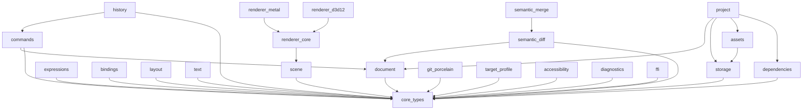

# Crate 의존 그래프 (II.2.8)

제품 crate 간 허용된 **직접** 의존 방향입니다. 이 문서는 사람용 기준이고, 강제는
`cargo xtask validate-crate-graph`(정책: `tools/xtask/src/crate_graph.rs`)가 수행합니다.
역방향·금지 edge는 CI에서 실패합니다.

## 허용 의존 표

| crate | 허용 직접 의존 |
|---|---|
| `stellar-core-types` | (없음) |
| `stellar-document` | core-types |
| `stellar-commands` | document, core-types |
| `stellar-history` | commands, core-types |
| `stellar-expressions` | core-types |
| `stellar-bindings` | core-types |
| `stellar-layout` | core-types |
| `stellar-text` | core-types |
| `stellar-scene` | core-types |
| `stellar-renderer-core` | scene |
| `stellar-renderer-metal` | renderer-core |
| `stellar-renderer-d3d12` | renderer-core |
| `stellar-storage` | core-types |
| `stellar-assets` | storage |
| `stellar-dependencies` | core-types |
| `stellar-project` | core-types, document, storage, assets, dependencies, git-porcelain |
| `stellar-semantic-diff` | document, core-types |
| `stellar-semantic-merge` | semantic-diff |
| `stellar-git-porcelain` | core-types |
| `stellar-target-profile` | core-types |
| `stellar-accessibility` | core-types |
| `stellar-diagnostics` | core-types |
| `stellar-ffi` | core-types |

## Mermaid

## 규칙

- `commands`와 `history`는 이미 `document`를 거쳐 `core-types`에 전이 의존하므로, StableId·WindowSessionId·DocumentRevision 같은 기본 타입을 직접 쓰도록 `core-types` 직접 의존을 허용합니다(2026-11-14, `semantic-diff` 선례와 같음).
- `git-porcelain`은 `document`를 직접 의존하지 않고 snapshot 인터페이스(빈 trait)에만 의존합니다.
- 플랫폼 backend(`renderer-metal`/`renderer-d3d12`)는 공통 backend(`renderer-core`)를 역참조하지 않습니다.
- 표에 없는 edge는 금지이며 `validate-crate-graph`가 `forbidden-edge`로 거부합니다.
