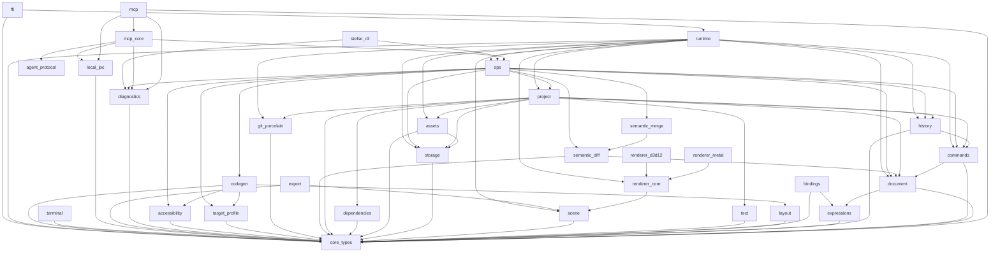

# Crate 의존 그래프 (II.2.8)

제품 crate 간 허용된 **직접** 의존 방향입니다. 이 문서는 사람용 기준이고, 강제는
`cargo xtask validate-crate-graph`(정책: `tools/xtask/src/crate_graph.rs`)가 수행합니다.
역방향·금지 edge는 CI에서 실패합니다.

## 허용 의존 표

| crate | 허용 직접 의존 |
|---|---|
| `stellar-core-types` | (없음) |
| `stellar-document` | core-types, expressions |
| `stellar-commands` | document, core-types |
| `stellar-history` | commands, core-types |
| `stellar-expressions` | core-types |
| `stellar-bindings` | core-types, expressions |
| `stellar-layout` | core-types |
| `stellar-text` | core-types |
| `stellar-scene` | core-types |
| `stellar-renderer-core` | scene |
| `stellar-renderer-metal` | renderer-core |
| `stellar-renderer-d3d12` | renderer-core |
| `stellar-storage` | core-types |
| `stellar-assets` | storage, core-types |
| `stellar-dependencies` | core-types |
| `stellar-project` | core-types, document, storage, assets, dependencies, git-porcelain, commands, history, text |
| `stellar-semantic-diff` | document, core-types |
| `stellar-semantic-merge` | semantic-diff |
| `stellar-git-porcelain` | core-types |
| `stellar-target-profile` | core-types |
| `stellar-accessibility` | core-types |
| `stellar-diagnostics` | core-types |
| `stellar-export` | core-types, scene |
| `stellar-mcp` | mcp-core, core-types, diagnostics, local-ipc |
| `stellar-mcp-core` | ops, agent-protocol, local-ipc, diagnostics |
| `stellar-local-ipc` | core-types |
| `stellar-terminal` | core-types |
| `stellar-codegen` | core-types, target-profile, accessibility, layout |
| `stellar-ops` | project, document, commands, history, storage, semantic-diff, semantic-merge, diagnostics, codegen, accessibility, target-profile |
| `stellar-cli` | ops, diagnostics |
| `stellar-runtime` | core-types, document, commands, history, project, storage, assets, renderer-core, scene, ops, git-porcelain |
| `stellar-ffi` | core-types, runtime |

## Mermaid

## 규칙

- 선택 staging 후보(XIV.5.5)는 `ops`의 무손실 저장 직렬화와 `git-porcelain`의 index·임시 tree API를
  `runtime`에서 조합합니다(ADR-0013). `ops`의 직접 의존과 `git-porcelain`·`semantic-diff`의 경계는 유지합니다.

- `document`·`bindings`는 표현식 AST를 저장·평가 입력으로 쓰므로 `expressions`에 의존합니다. `project`는 Command 단위 자동 저장·복구를 위해 `commands`·`history`에 의존하고, 프로젝트·시스템 폰트 등록(XIII.6)을 위해 `text`에 의존합니다(2026-11-14, 순환 없음).
- `codegen`(ADR-0049)은 문서·binding 계층에 의존하지 않고 target-profile·accessibility·layout의 지역 모델로 만든
  IR만 읽습니다. 생성 코드를 되읽는 crate는 없습니다(단방향, 2026-11-14).
- 셸 경계(`ffi`)는 문서·프로젝트 작업에 `runtime`을 통해서만 도달합니다(ADR-0013, 2026-11-14).
- `runtime`은 창 session의 viewport를 scene camera 입력(`stellar_scene::visibility::Viewport`)으로 만들고 selection overlay를 transient scene layer로 만들기 위해 `scene`에 직접 의존합니다(ADR-0028, 2026-11-14, 순환 없음).
- `commands`와 `history`는 이미 `document`를 거쳐 `core-types`에 전이 의존하므로, StableId·WindowSessionId·DocumentRevision 같은 기본 타입을 직접 쓰도록 `core-types` 직접 의존을 허용합니다(2026-11-14, `semantic-diff` 선례와 같음).
- `assets`도 같은 이유로 `core-types` 직접 의존을 허용합니다. AssetId는 계획서(XIII.5.1)대로 StableId newtype입니다(2026-11-14).
- `git-porcelain`은 `document`를 직접 의존하지 않고 snapshot 인터페이스(빈 trait)에만 의존합니다.
- 플랫폼 backend(`renderer-metal`/`renderer-d3d12`)는 공통 backend(`renderer-core`)를 역참조하지 않습니다.
- 표에 없는 edge는 금지이며 `validate-crate-graph`가 `forbidden-edge`로 거부합니다.
