# Crate 의존 그래프 (II.2.8)

제품 crate 간 허용 직접 의존과 전이 도달 금지 규칙입니다. 이 문서는 사람용 기준이고, 강제는
`cargo xtask validate-crate-graph`가 수행합니다. 허용 직접 의존 정책은 `tools/xtask/src/crate_graph.rs`의
`allowed_edges()`, 전이 도달 금지 정책은 `tools/xtask/src/crate_graph/reach.rs`의 `FORBIDDEN_REACH`에 있습니다.
역방향·금지 edge와 금지 도달은 이 검사에서 실패합니다(로컬 `cargo xtask check-core`가 함께 실행).

## 검사 범위

- 검사 대상 manifest: `crates/*/Cargo.toml`, `tools/stellar-*/Cargo.toml`, 그리고 Cargo workspace member 전체입니다.
  workspace member는 루트 `[workspace].members`(`dir/*` glob만 펼침), 루트가 package이면 루트 자신, path 의존으로
  생기는 자동 member(재귀)를 Cargo 규칙대로 모으고 `[workspace].exclude`를 반영합니다.
- 읽는 의존 표: `[dependencies]`, `[build-dependencies]`, `[dev-dependencies]`, `[target.<spec>.*]`입니다. 하위 표
  (`[dependencies.<name>]`), dotted key(`<name>.path = ...`), inline table 형태, `package = "..."` 이름 변경,
  `workspace = true` 상속을 모두 실제 package 이름으로 해석하고, 모든 표를 같은 허용 표로 검사합니다. 해석할 수
  없는 구문은 거부합니다(fail closed).
- 제외: `tools/xtask`, `benchmarks/fixtures`(ADR-0019), crate 사이 종단 시나리오 테스트 crate `tests/integration`.
  제외 crate의 path 의존으로 생기는 자동 member는 검사합니다.
- 정책 표에 없는 package는 이름이 `stellar-`로 시작하지 않아도, 의존이 없어도 `unknown-crate`로 거부합니다.

## 허용 의존 표

| crate | 허용 직접 의존 |
|---|---|
| `stellar-core-types` | (없음) |
| `stellar-document` | core-types, expressions |
| `stellar-commands` | document, core-types |
| `stellar-history` | commands, core-types |
| `stellar-expressions` | core-types |
| `stellar-bindings` | core-types, expressions |
| `stellar-layout` | core-types |
| `stellar-text` | core-types |
| `stellar-scene` | core-types, document, commands(`document` feature, ADR-0116) |
| `stellar-renderer-core` | scene |
| `stellar-renderer-metal` | renderer-core, export, scene, core-types(test) |
| `stellar-renderer-d3d12` | renderer-core |
| `stellar-storage` | core-types |
| `stellar-assets` | storage, core-types |
| `stellar-dependencies` | core-types |
| `stellar-project` | core-types, document, storage, assets, dependencies, git-porcelain, commands, history, text |
| `stellar-semantic-diff` | document, core-types |
| `stellar-semantic-merge` | semantic-diff |
| `stellar-git-porcelain` | core-types |
| `stellar-target-profile` | core-types |
| `stellar-accessibility` | core-types |
| `stellar-diagnostics` | core-types |
| `stellar-export` | core-types, scene, renderer-core |
| `stellar-mcp` | mcp-core, core-types, diagnostics, local-ipc |
| `stellar-mcp-core` | ops, agent-protocol, local-ipc, diagnostics |
| `stellar-local-ipc` | core-types |
| `stellar-agent-protocol` | core-types |
| `stellar-agent-host` | core-types, agent-protocol, local-ipc, diagnostics |
| `stellar-terminal` | core-types |
| `stellar-codegen` | core-types, target-profile, accessibility, layout |
| `stellar-prototype` | core-types, expressions, document, bindings |
| `stellar-ops` | project, document, commands, history, storage, semantic-diff, semantic-merge, diagnostics, codegen, accessibility, target-profile, git-porcelain, integrity, export, scene, assets |
| `stellar-integrity` | core-types, document, commands, bindings, expressions, text, accessibility, dependencies, target-profile |
| `stellar-cli` | ops, diagnostics |
| `stellar-runtime` | core-types, document, commands, history, project, storage, assets, renderer-core, scene, text, ops, git-porcelain, agent-host |
| `stellar-ffi` | core-types, runtime |
| `stellar-plugin-host` | ops, project, storage, git-porcelain |

## Mermaid

```mermaid
graph TD
  mcp --> mcp_core
  mcp --> core_types
  mcp --> diagnostics
  mcp --> local_ipc
  mcp_core --> ops
  mcp_core --> agent_protocol
  mcp_core --> diagnostics
  mcp_core --> local_ipc
  agent_protocol --> core_types
  agent_host --> agent_protocol
  agent_host --> local_ipc
  document --> core_types
  document --> expressions
  commands --> document
  commands --> core_types
  history --> commands
  history --> core_types
  expressions --> core_types
  bindings --> core_types
  bindings --> expressions
  layout --> core_types
  text --> core_types
  scene --> core_types
  scene --> document
  scene --> commands
  renderer_core --> scene
  renderer_metal --> renderer_core
  renderer_metal --> export
  renderer_metal --> scene
  renderer_d3d12 --> renderer_core
  storage --> core_types
  assets --> storage
  assets --> core_types
  dependencies --> core_types
  project --> document
  project --> core_types
  project --> git_porcelain
  project --> storage
  project --> assets
  project --> dependencies
  project --> commands
  project --> history
  project --> text
  semantic_diff --> document
  semantic_diff --> core_types
  semantic_merge --> semantic_diff
  git_porcelain --> core_types
  target_profile --> core_types
  accessibility --> core_types
  diagnostics --> core_types
  export --> core_types
  local_ipc --> core_types
  export --> scene
  export --> renderer_core
  terminal --> core_types
  codegen --> core_types
  codegen --> target_profile
  codegen --> accessibility
  codegen --> layout
  prototype --> core_types
  prototype --> expressions
  prototype --> document
  prototype --> bindings
  ops --> codegen
  ops --> project
  ops --> document
  ops --> commands
  ops --> history
  ops --> storage
  ops --> semantic_diff
  ops --> semantic_merge
  ops --> diagnostics
  ops --> accessibility
  ops --> target_profile
  ops --> git_porcelain
  ops --> integrity
  ops --> export
  ops --> scene
  ops --> assets
  integrity --> core_types
  integrity --> document
  integrity --> commands
  integrity --> bindings
  integrity --> expressions
  integrity --> text
  integrity --> accessibility
  integrity --> dependencies
  integrity --> target_profile
  stellar_cli --> ops
  stellar_cli --> diagnostics
  runtime --> core_types
  runtime --> document
  runtime --> commands
  runtime --> history
  runtime --> project
  runtime --> storage
  runtime --> assets
  runtime --> renderer_core
  runtime --> scene
  runtime --> text
  runtime --> ops
  runtime --> git_porcelain
  runtime --> agent_host
  ffi --> core_types
  ffi --> runtime
  plugin_host --> ops
  plugin_host --> project
  plugin_host --> storage
  plugin_host --> git_porcelain
```

## 전이 도달 금지(ADR-0005 §8)

ADR-0005 §8 crate 배치 표의 "전이적으로도 도달 금지" 열입니다. crate X의 도달 집합은 X 자신의 모든 의존 표(dev
포함)에서 시작하고, 그 뒤로는 의존 crate를 빌드할 때 함께 빌드되는 normal·build 의존(target 한정 포함)만
따라갑니다. 위반은 `forbidden-reach`로 최단 경로와 함께 보고합니다. 아직 workspace에 없는 crate의 규칙은 그 crate가
생기는 순간부터 적용됩니다.

| crate | 전이적으로도 도달 금지 |
|---|---|
| `stellar-mcp-core` | agent-host, runtime, ffi |
| `stellar-ops` | local-ipc, agent-protocol, mcp-core, mcp, agent-host, ffi |
| `stellar-cli` | local-ipc, agent-protocol, mcp-core, mcp, agent-host |
| `stellar-local-ipc` | document, commands, ops |
| `stellar-agent-protocol` | commands, document, ops, agent-host |
| `stellar-mcp` | agent-host, ffi |
| `stellar-agent-host` | document, commands, history, storage, ops |
| `stellar-runtime` | mcp-core |

- `stellar-ffi`는 이 열 대신 타입 변환 금지 inventory로 보완하므로 규칙이 없습니다.
- `stellar-mcp` 행은 ADR-0005 §8 표에 행이 없고, XXIX.1.1 검사기가 실행 파일 package(`tools/stellar-mcp`)에 따로 둔 규칙입니다.

## 규칙

- 선택 staging 후보(XIV.5.5)는 `ops`의 무손실 저장 직렬화와 `git-porcelain`의 index·임시 tree API를
  `runtime`에서 조합합니다(ADR-0013). `ops`의 직접 의존과 `git-porcelain`·`semantic-diff`의 경계는 유지합니다.

- `document`·`bindings`는 표현식 AST를 저장·평가 입력으로 쓰므로 `expressions`에 의존합니다. `project`는 Command 단위 자동 저장·복구를 위해 `commands`·`history`에 의존하고, 프로젝트·시스템 폰트 등록(XIII.6)을 위해 `text`에 의존합니다(2026-11-14, 순환 없음).
- `ops`는 `stellar git` 명령(ADR-0080)의 Git 경로를 위해 `git-porcelain`에 직접 의존합니다(ADR-0005 §8 표 개정, 순환 없음).
- `codegen`(ADR-0049)은 문서·binding 계층에 의존하지 않고 target-profile·accessibility·layout의 지역 모델로 만든
  IR만 읽습니다. 생성 코드를 되읽는 crate는 없습니다(단방향, 2026-11-14).
- 셸 경계(`ffi`)는 문서·프로젝트 작업에 `runtime`을 통해서만 도달합니다(ADR-0013, 2026-11-14).
- `runtime`은 창 session의 viewport를 scene camera 입력(`stellar_scene::visibility::Viewport`)으로 만들고 selection overlay를 transient scene layer로 만들기 위해 `scene`에 직접 의존합니다(ADR-0028, 2026-11-14, 순환 없음).
- `commands`와 `history`는 이미 `document`를 거쳐 `core-types`에 전이 의존하므로, StableId·WindowSessionId·DocumentRevision 같은 기본 타입을 직접 쓰도록 `core-types` 직접 의존을 허용합니다(2026-11-14, `semantic-diff` 선례와 같음).
- `assets`도 같은 이유로 `core-types` 직접 의존을 허용합니다. AssetId는 계획서(XIII.5.1)대로 StableId newtype입니다(2026-11-14).
- `git-porcelain`은 `document`를 직접 의존하지 않고 snapshot 인터페이스(빈 trait)에만 의존합니다.
- `scene`은 `document` feature에서만 `document`·`commands`에 의존합니다. 문서 → scene source 변환을 앱 runtime과 headless
  도구(`ops`·CLI·MCP)가 함께 쓰기 위해서입니다. `renderer-core`·`export`는 feature를 켜지 않습니다(ADR-0116 결정 1, 순환 없음).
- `ops`는 PNG 내보내기의 이미지 asset 내용(asset metadata record와 content store)을 읽으려고 `assets`에 직접 의존합니다
  (ADR-0116 결정 5).
- `renderer-metal`은 PNG 내보내기 Metal offscreen target이 export 렌더 계약(`OffscreenTarget`)을 구현하려고 `export`·`scene`에
  의존합니다. export·ops·CLI는 GPU backend에 의존하지 않으므로 방향이 반대로 생기지 않습니다(ADR-0116 결정 4, 순환 없음).
- 플랫폼 backend(`renderer-metal`/`renderer-d3d12`)는 공통 backend(`renderer-core`)를 역참조하지 않습니다.
- 표에 없는 edge는 금지이며 `validate-crate-graph`가 `forbidden-edge`로 거부합니다.
